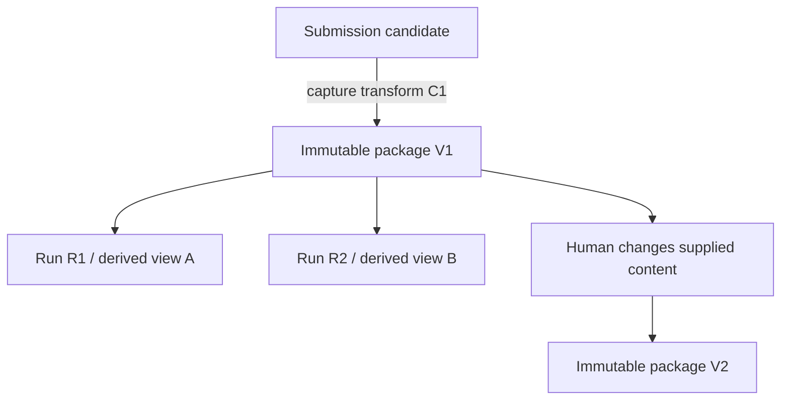
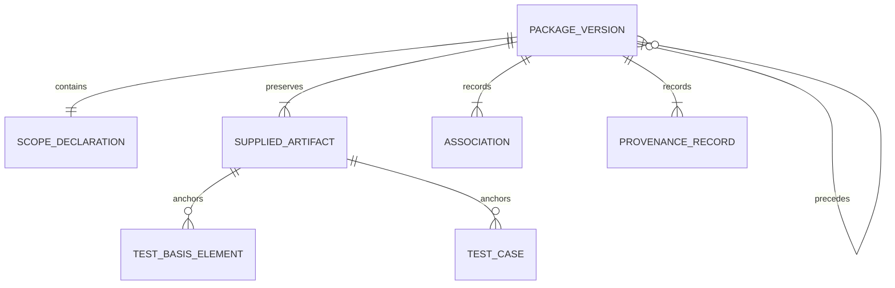

# Test Design Gatekeeper

## RA-03 — Review Package Content, Provenance, Validation, and Input Sufficiency

| Field | Value |
| --- | --- |
| Basis | Accepted RA-03 v0.4, originally dated 2026-09-21 |
| Requirement acceptance | All 50 requirements accepted; v0.3 designated under [PG-RA03-001 v0.2][gate03-current], 2026-09-15 |
| Current baseline | v0.4 and its two input-sufficiency corrections accepted on 2026-09-21; recorded in [SR-RA10-001 v0.2][review10-current] |
| Text maintenance | Consolidated on 2026-10-21; numbered sections and requirement, validation, rule and decision identifiers retained |
| Decision authority | Project Owner |
| Upstream scope | [Charter v0.4][charter], [RA-01 v0.3][ra01] and [RA-02 v0.3][ra02] |

This document defines what a review package must contain, how TDG preserves the origin of its data, and how missing or conflicting information limits an assessment. The requirements are accepted; that does not mean the behavior is implemented or tested. Current capability and the development pause are described in [README.md](../../../README.md).

The [original v0.4 text][original] remains in Git history. Hashes and byte counts in earlier reviews and trace ledgers identify that historical snapshot, not this maintained text. The accepted corrections are included below; Section 22 links to their review history.

## 1. Purpose

Define the input needed for a supported assessment. Import success alone does not establish that input is sufficient, a test is good, or a suite is complete. TDG must preserve missing and conflicting information, keep its own interpretations separate from supplied facts, and leave corrections to the responsible human.

## 2. Scope of RA-03

RA-03 governs the logical package contents, minimum input, relationships, provenance, validation issues, immutable versions and lineage. Its model does not depend on a file format or implementation technology.

Related requirements govern scope qualification (RA-04), results and history (RA-05), the four supported techniques (RA-06), LLM roles (RA-07), security and privacy (RA-08), input/export formats (RA-09), and evaluation and acceptance (RA-10). Section 21.2 links to those sources. RA-03 supplies their input boundaries without duplicating their detailed contracts or defining architecture and executable tests.

## 3. Source baseline and precedence

| Source | Contribution to RA-03 |
| --- | --- |
| [Charter v0.4][charter], Sections 6–13 and 15–17 | Product scope, minimum package, supplied-data and confidentiality boundaries, synthetic example and evaluation evidence |
| Requirements Analysis Entry Record v0.1 | Inputs `RA-IN-002` through `RA-IN-006` and `RA-IN-008` |
| [RA-01 v0.3][ra01] | Human roles and authority, supplied-data boundary, combined roles and operating profiles |
| [RA-02 v0.3][ra02] | Workflow, alternate paths, package/run separation and routed RA-03 obligations |
| `PG-RA02-001` | Historical authorization to begin RA-03, granted on 2026-09-09 |
| [PG-RA03-001 v0.2][gate03-current] | Requirement acceptance, upstream amendments, v0.3 baseline designation and historical GO to RA-04 |
| [SR-RA10-001 v0.2][review10-current] | Accepted v0.4 input-sufficiency corrections and replacement baseline |

The Charter governs product scope, RA-01 governs human authority, and RA-02 governs workflow. An unresolved conflict requires an explicit decision rather than a silent reinterpretation. Historical entry and exit decisions do not override the current development pause.

### 3.1 Upstream wording requiring clarification or correction

Both upstream actions are closed under [PG-RA03-001][gate03-current]:

- `RA03-UA-001`: `OD-RA03-001` and `CR-RA03-003` distinguish capture/import mapping from assessment interpretation. RA-02 v0.3 records their different package-version and run consequences.
- `RA03-UA-002`: `OD-RA03-004` and `CR-RA03-001` replace authorship purity with explicit ROLE-03 accountability for human-authored or human-controlled AI-assisted testware. The correction is in Charter v0.4, including `D-004`, and RA-01 v0.3. `CR-RA03-002` also preserves an attributable experience-based test basis in the Charter without adding another technique to the MVP.

These decisions do not authorize test generation, autonomous repair, authorship inference or review of AI/LLM systems as a target domain. ROLE-01 through ROLE-10 and their authority are defined in [RA-01][ra01], not redefined here.

## 4. Terminology

| Term | Meaning in RA-03 |
| --- | --- |
| Submission candidate | Deliberately selected files, records, declarations, or other local material offered for intake before TDG has established an immutable package snapshot or attributable rejection |
| Submission context | Operational record of who submitted what, when, under which declared role and operating profile; distinct from the supplied business content |
| Capture transformation | Identified parsing, import mapping, or fail-visible structural normalization used to create a traceable logical package snapshot from deliberately supplied source artifacts |
| Review Package lineage | Human-controlled sequence or branch of related package versions concerning the same declared review purpose |
| Review Package version | Immutable identity for the exact supplied source content, human declarations, and captured logical projection established through an identified capture transformation |
| Package manifest | Logical inventory that identifies the package version, its content items, relationships, provenance, and lineage without prescribing a physical format |
| Scope declaration | Human-supplied or human-confirmed statement of the bounded feature or small process intended for review |
| Supplied artifact | An immutable content instance deliberately included in the submission, such as a document, structured row set, diagram, excerpt, or test-case export |
| Test-basis element | An addressable supplied requirement, user story, acceptance criterion, business rule, risk, prior defect, state description, decision rule, process fragment, attributable experience-based rationale, or other basis item |
| Test case | An addressable test-design item submitted for review; positive MVP eligibility requires an accepted origin declaration plus attributable ROLE-03 accountability, while other origins remain preserved as negative, unsupported, or undetermined input |
| Behavioral segment | Non-title supplied content expressing at least one test condition, input or test datum, action, event, expected behavior, outcome, or equivalent behavioral statement; an identifier, title, link, or precondition alone is not a behavioral segment |
| Experience-based rationale | A human-supplied and attributable statement that a test derives from risk, a prior defect, an observed failure, a heuristic, or relevant experience; it is evidence of the declared design basis, not invented requirement coverage or proof that a formal requirement exists |
| Source locator | Stable location within a supplied artifact that allows a human or TDG to find the cited content in that exact package version |
| Provenance assertion | Supplied or system-recorded information about an item's origin, identity, version, supplier, capture, or relationship to another source |
| Scope-membership association | Human declaration that an item is submitted as a candidate member of the package boundary; not proof of detailed requirement coverage |
| Direct trace link | Supplied explicit relationship between a test case and one or more test-basis elements |
| Derived assessment view | Version-identified semantic mapping, extraction, or interpretation used by an assessment run after package capture; it references but does not mutate the supplied package version |
| Opaque artifact | Supplied item whose substantive content cannot be addressed by the active intake capability; it may be inventoried but not silently treated as evaluated evidence |
| Core-minimum content | Information whose absence prevents substantive review of the package as a whole |
| Conditional evidence | Information required only for a specified assessment, technique, item, or claim; its absence limits the affected assessment rather than automatically invalidating the package |
| Supplementary content | Information that may improve review quality but whose absence alone does not block a supported assessment |
| System-recorded metadata | Identity, time, integrity, or operational context recorded by TDG without being represented as a supplied business fact |
| Internal identifier | TDG-controlled identity used to distinguish a package item even when its external source lacks a reliable identifier |
| External identifier | Identifier declared by the supplied source, retained as source data and not assumed unique or correct without validation |
| Minimum admissibility | The core input conditions for proceeding to qualification; a particular requested assessment may still lack necessary evidence, as specified in Section 15.3 |
| Assessment-specific sufficiency | Availability of the particular evidence required for one requested review dimension or technique |

Detailed entity and lifecycle contracts are defined in [RA-05][ra05]; physical representations are defined in [RA-09][ra09].

## 5. Review Package principles

| ID | Principle |
| --- | --- |
| RP-01 | Supplied content, human declarations, system observations, and TDG-derived interpretations remain distinguishable |
| RP-02 | TDG establishes stable identity and provenance before relying on semantic content |
| RP-03 | Minimum admissibility means that review may begin; it is not a quality, completeness, or approval verdict |
| RP-04 | Package membership is not direct test-basis-to-test-case traceability |
| RP-05 | A generated internal identifier may preserve identity but must not conceal a missing, duplicate, or conflicting external identifier |
| RP-06 | An input problem has the narrowest defensible consequence: package-wide only when a non-separable minimum or policy condition fails |
| RP-07 | An assessed package version is immutable; human changes create a distinct version and preserve lineage |
| RP-08 | A reference to external material neither supplies that material nor authorizes TDG to retrieve it |
| RP-09 | Provenance supports attribution and reviewability; it does not by itself prove source truth, authority, or authenticity |
| RP-10 | Logical content semantics remain independent of JSON, CSV, Jira, Xray, Zephyr, document, or UI representation |
| RP-11 | TDG does not silently repair supplied content, identifiers, relationships, or source precedence |
| RP-12 | The package preserves enough evidence for later difficult classification and technique analysis without performing those later analyses in RA-03 |

## 6. Three-layer intake model

Keep the submission operation, captured source and assessment interpretation separate.

| Layer | Contains | May change when | Must not be represented as |
| --- | --- | --- | --- |
| Submission context | Actor, acting role, operating profile, request time, selected local inputs, applicable operational configuration | A new submission or operational request occurs | Supplied business rule or immutable package content |
| Immutable package version | Exact supplied artifacts, human declarations, traceable logical item projection, capture-transformation identity, scope, provenance, associations, and lineage reference | Never in place; changed supplied content or recapture under a changed import transformation creates a new version | Assessment result, mutable working copy, or semantic model interpretation |
| Derived assessment view | Versioned assessment mapping, semantic extraction, normalization, and interpretation used by one assessment | A new run uses changed assessment behavior, prompt, model, rule, control, or configuration | Original supplied fact or a silent package revision |

A capture/import transformation establishes the logical projection of supplied content. Recapturing under a changed transformation creates a new package version. An assessment mapping interprets an existing package; changing it creates a new run. Human changes to scope, sources, testware, supplied associations or provenance declarations also create a new package version. Section 16 lists the triggers.

Safe, permitted capture may preserve a snapshot that later fails the package minimum. If exact trustworthy capture is impossible, TDG records only an attributable rejection. Neither outcome is a completed substantive review.

## 7. Logical content inventory

### 7.1 Content categories

| Category | Meaning | Absence consequence |
| --- | --- | --- |
| CORE MINIMUM | Required to establish one minimally admissible Review Package | Blocks substantive review of the package |
| CONDITIONAL | Required for a particular item, requested assessment, technique, or evidentiary claim | Blocks or limits only the dependent assessment where separable |
| SUPPLEMENTARY | Potentially useful context not required by itself | No automatic block; limitation may still be reported |
| SYSTEM RECORDED | Created by TDG for identity, integrity, attribution, or operation | Failure to record may block the affected operation, but the value is not a supplied business fact |

### 7.2 Object inventory and cardinality

| Logical object | Cardinality per package version | Category | Principal source or authority | Purpose |
| --- | ---: | --- | --- | --- |
| Package manifest, internal package-version identity, and capture-transformation identity | Exactly 1 | SYSTEM RECORDED | TDG | Inventory, immutable package reference, and reproducible logical capture |
| Review Package lineage identity | Exactly 1 | SYSTEM RECORDED or human-selected existing lineage | TDG under human-controlled submission | Relate versions without overwriting history |
| Direct predecessor reference | 0 or 1 | CONDITIONAL | Human declaration validated by TDG | Record derivation from an earlier package version |
| Scope declaration | Exactly 1 | CORE MINIMUM | ROLE-02 decision, possibly recorded through ROLE-01 | Bound the feature or small process |
| Supplied artifact | 1 or more | CORE MINIMUM | Human-supplied | Preserve exact submitted content containers |
| Test-basis element | 1 or more | CORE MINIMUM | Human-supplied and anchored to a supplied artifact | Provide an addressable basis for review |
| Test case | 1 or more recognizable items; at least 1 must meet the accepted origin-and-accountability rule, while remaining cases may declare another origin | CORE MINIMUM | Supplied testware under attributable ROLE-03 accountability for positive eligibility | Provide the test design to review without silently discarding mixed-origin items |
| Scope-membership association | At least 1 for every basis element and test case | CORE MINIMUM | Human declaration through package assembly | State intended package membership without claiming detailed coverage |
| Direct trace link | 0 or more | CONDITIONAL or SUPPLEMENTARY | Supplied source or human declaration | Express explicit basis-to-test-case traceability where available |
| Provenance record | At least 1 per supplied artifact and addressable item | CORE MINIMUM | Supplied declaration plus system observation | Preserve source identity and location |
| Context declaration | 0 or more | CONDITIONAL or SUPPLEMENTARY | Human-supplied | Record declared test level, type, execution mode, role, objective, environment, or other context |
| Risk item | 0 or more | CONDITIONAL or SUPPLEMENTARY | Human-supplied | Support risk-coverage assessment when requested |
| Supporting evidence or attachment | 0 or more | CONDITIONAL or SUPPLEMENTARY | Human-supplied | Supply diagrams, matrices, examples, or excerpts |
| Package-level note or open question | 0 or more | SUPPLEMENTARY | Human-supplied | Preserve known uncertainty without inventing an answer |

One supplied artifact may contain many basis elements, many test cases, or both. Cardinality applies to logical addressable items, not necessarily to the number of physical files.

## 8. Structural relationships

The logical relationships require that:

- every test-basis element and test case belongs to exactly one immutable package version;
- every addressable supplied item points to one supplied artifact and one stable source locator or whole-artifact marker;
- every supplied artifact and addressable item has package-local identity and provenance;
- every basis element and test case has a scope-membership association;
- a direct trace link may relate many test cases to many basis elements;
- missing direct trace links remain visible and are never replaced by silent inferred links;
- a package version may identify at most one direct predecessor in the accepted MVP lineage model, while one predecessor may have multiple later variants;
- assessment runs, findings, human dispositions, and exports reference the package version but are not contained as supplied package content.

## 9. Scope declaration

### 9.1 Core-minimum scope semantics

The declaration must identify a readable title, target business/application context, one feature or small process, included behavior, and the responsible ROLE-02 or attributable combined-role decision. Optional context includes exclusions, objectives, user roles, dependencies, interfaces, environment, requested review dimensions and known limitations.

### 9.2 Structural presence versus qualified boundary

RA-03 checks that scope is identifiable, non-empty and connected to supplied items. RA-04 decides its qualification. A cross-process, multi-feature, inconsistent or mismatched boundary remains visible; TDG cannot silently narrow it to make the package pass.

### 9.3 Authority behavior

A valid explicit ROLE-02 scope decision need not be repeated for every run against the unchanged package version. Missing, ambiguous, changed or TDG-proposed scope requires a new ROLE-02 decision. An LLM cannot establish authoritative scope.

## 10. Supplied artifacts and test-basis elements

### 10.1 Supplied artifact minimum

Each artifact needs an internal identifier, readable source label, exact retained content or an integrity-protected reference to content retained inside the snapshot, provenance and a package-version relationship. Record the content kind where declared or observed.

An external path, URL, issue key, document number or filename may identify an origin; it does not supply the content or permit retrieval. A human must deliberately import additional content through an authorized path into a new package version.

### 10.2 Test-basis element semantics

An element can be a supplied requirement, story, use case, acceptance criterion, business rule, constraint, risk, prior defect, observed failure, heuristic or attributable experience-based rationale. It can also describe a process path, state, event, transition, guard, decision condition/action/rule, or an addressable excerpt, diagram fragment or table row. Other and unknown kinds remain allowed.

Each element needs internal identity, an anchor to one supplied artifact, a stable locator or explicit whole-artifact marker, and substantive content accessible inside the snapshot. A missing or disputed kind may limit classification or assessment; it never authorizes source rewriting.

### 10.3 Addressable versus opaque content

Preserve and inventory opaque artifacts, but do not count them as sufficient test-basis evidence unless an authorized capability exposes reviewable, addressable content or a human supplies an addressable excerpt or description. Authorized OCR or equivalent extraction must retain its artifact locator, derivation and uncertainty. Extraction success does not prove semantic correctness.

Presence alone does not establish that a diagram, scan, binary attachment, inaccessible reference or unsupported format was evaluated. A Jira-shaped file is assessed by supplied content and its declared import profile; its fields do not prove Jira produced it, and TDG need not authenticate that origin.

### 10.4 Supplied content versus extracted interpretation

A TDG-extracted rule, state, boundary, condition or trace link belongs to the derived assessment view, with source evidence, derivation, uncertainty and behavior identity. It enters supplied package content only through deliberate human incorporation into a new version.

Human confirmation may instead authorize a bounded interpretation for an assessment without editing the snapshot. [RA-05 §5.1][ra05] governs whether that decision can support an active run or requires a new run; a terminal run cannot resume.

## 11. Test-case logical representation

### 11.1 Representation-neutral test case

Classic fields, step tables, narrative scenarios, Given/When/Then and other supported forms are eligible when their semantics remain addressable and can be preserved without invention. RA-03 requires no single editorial template.

### 11.2 Accepted recognizable-case and positive-eligibility boundary

Under `OD-RA03-002`, a recognizable test case needs:

- a supplied identifier or visible package-local internal identifier;
- a non-empty title, summary, objective or scenario description;
- at least one deliberately supplied, non-title behavioral segment: a test condition, input/data, action, event, expected behavior, outcome or equivalent test content.

An identifier, title, link or precondition alone is insufficient, even in combination without a behavioral segment. Preserve such an item and its deficiency. Recognizability is not completeness: a case with an action but no expected result remains recognizable, while the missing outcome is a material gap or assessment limitation. Preconditions are required when state, data, authority, environment or another prerequisite matters. Expected behavior may be per step or in an addressable narrative.

To meet the package minimum, a recognizable case also needs supplied-testware anchoring, scope membership, identifiable provenance and an explicit origin declaration for the item or an unambiguous containing set. At least one case must be declared human-authored or human-controlled with AI assistance, with an identified ROLE-03 accepting accountability. Other cases remain visible and do not acquire eligibility from that case.

### 11.3 Test-case content dimensions

| Content dimension | Minimum status | Absence or ambiguity consequence |
| --- | --- | --- |
| Internal identity | Required | Item cannot be referenced reliably until TDG assigns a visible local identity |
| Source artifact and locator | Required | Provenance and evidence are insufficient for that item |
| Title, summary, objective, or scenario description | Required for recognizability | Item is preserved but does not count as a recognizable test case |
| At least one non-title behavioral segment | Required for recognizability | Identifier, title, link, or precondition alone remains structurally insufficient |
| Testware-origin declaration | Required for every test case, either directly or through an unambiguous containing set | Unknown, missing, mixed, or conflicting origin remains visible; TDG must not infer a value from style |
| ROLE-03 accountability declaration | Required for a recognizable case to satisfy the positive MVP origin rule | The case remains preserved but cannot satisfy the package minimum by itself |
| Preconditions | Conditional and required when applicable | May create a reviewable gap or limit interpretation; does not automatically reject the package |
| Steps, actions, or events | Conditional | Required when the representation and requested assessment depend on them |
| Input or test data | Conditional | Limits data-domain, EP, BVA, or rule assessment where relevant |
| Expected result or observable outcome | Conditional; may be per step or in an addressable narrative | Its absence does not erase recognizability when other behavioral content exists, but creates a material content gap or may make observability or coverage assessment ungradable |
| Postcondition | Supplementary or conditional | Required only when later behavior depends on the resulting state |
| Test level, test type, design basis, or execution mode declarations | Conditional | Missing or conflicting declarations route to RA-04; labels are not verdicts |
| Priority, business risk, owner, lifecycle status, or environment | Supplementary or conditional | Limits only assessments that rely on that context |
| Direct test-basis trace link | Conditional or supplementary | Absence may itself be reviewed as a traceability gap; it is not a minimum-intake failure |

Preserve empty, missing and ambiguous fields. Do not generate a precondition, step, input or expected result to make a case appear complete.

### 11.4 Human accountability and origin

Keep the supplied origin declaration distinct from human accountability. The origin meanings are human-authored; human-controlled with AI assistance; generated or supplied from another process without accountable human adoption; other; and unknown.

Under `OD-RA03-004`, the first two qualify only with explicit ROLE-03 accountability. Deliberate human adoption or correction can move generated content into the human-controlled class; recording that content or declaration change creates a new package version. Other origins remain preserved but cannot satisfy the positive minimum alone. RA-04 applies item-level consequences in mixed-origin packages.

TDG cannot establish authorship history or AI involvement from style, formatting, vocabulary, metadata patterns or perceived LLM characteristics. It cannot infer, challenge or upgrade origin on that basis. ROLE-03 alone controls changes to source testware.

## 12. Associations and traceability

### 12.1 Scope membership

Every basis element and case must be explicitly submitted as a candidate member of the declared scope; package assembly can record that association. Membership records human intent, not proof of scope eligibility or requirement coverage.

### 12.2 Direct trace links

Cases may have zero, one or multiple direct basis links. Missing links do not invalidate the package minimum: their absence may be the defect under review. Each supplied link must preserve its source and supplied/human-declared origin, addressable endpoints, any relationship type or rationale, and detected ambiguity, dangling references, duplicates or contradictions.

A human-supplied risk, prior defect, observed failure, heuristic or experience rationale may explain a case without a requirement link. Preserve that attribution; do not invent hidden tester experience, a nonexistent requirement or documented-requirement coverage. Such a basis supports general review without adding error guessing, exploratory testing, checklist-based testing or another detailed technique assessment. The initial techniques remain EP, BVA, Decision Table Testing and State Transition Testing.

### 12.3 Inferred association

A rule-derived or LLM-assisted candidate link belongs to an identified assessment run, with evidence, derivation and uncertainty. It starts without human acceptance and cannot silently satisfy deterministic traceability. Incorporating it into supplied package content creates a new version; accepting a suggestion alone is distinguishable from editing source or package metadata.

### 12.4 Orphans and mismatches

Keep unlinked, multiply linked, dangling and mismatched items visible. Unaffected items may remain assessable, but TDG cannot silently delete an orphan, redirect a reference or manufacture a relationship.

## 13. Provenance model

### 13.1 Minimum provenance set

For each supplied artifact and addressable basis/case item, preserve exact content identity, a readable source label or key, its location inside the snapshot, package version, capture transformation and submission context identifying actor and time. Preserve supplied external IDs, versions, authors, timestamps, systems, export and revision metadata without claiming independent verification. Label declarations, observations and inferences distinctly.

This supports attribution and inspection; it does not authenticate the originating organization, person, system or document.

### 13.2 Provenance evidence classes

| Evidence class | Example | Permitted meaning |
| --- | --- | --- |
| SUPPLIED DECLARATION | Operator states that a document is requirement version 4 | Retain the declaration and its supplier; do not label it independently verified |
| SUPPLIED SOURCE METADATA | Export contains a Jira key, author, or update time | Preserve the exact supplied value and source location |
| SYSTEM OBSERVATION | TDG records intake time, file size, detected type, or integrity identity | May support reproducibility; is not a business fact |
| HUMAN CONFIRMATION | ROLE-04 confirms an interpretation or precedence for an assessment | Authorizes the bounded human decision; does not rewrite the source snapshot automatically |
| DERIVED INFERENCE | LLM proposes that two differently named rules are equivalent | Assessment evidence only, with uncertainty; never supplied fact by default |

### 13.3 Provenance sufficiency meanings

These are evidence conditions; [RA-05][ra05] governs result and lifecycle statuses.

| Condition | Meaning | Default consequence |
| --- | --- | --- |
| Identifiable | Exact supplied content and source location can be distinguished inside the package | May support dependent assessment |
| Partial | Some origin metadata is absent, but exact package content and location remain identifiable | Limit only claims that require the missing metadata |
| Conflicting | Supplied origin, version, identity, or precedence information disagrees | Preserve conflict; block or narrow dependent claims |
| Unavailable | Exact supporting content or its package-local source cannot be identified | Does not satisfy the affected minimum or conditional evidence need |

Minimum provenance does not require an absolute workstation path. Prefer a readable logical label, internal identity, source locator and retained-content identity. [RA-08][ra08] and [RA-09][ra09] govern path handling and redaction.

### 13.4 Integrity identity

TDG must detect whether a run used the exact snapshot identified in its result. Algorithm and storage choices belong to design. A fingerprint is not proof of semantic equivalence, authenticity, ownership or permission, and identical bytes do not authorize automatic package merging.

## 14. Conditional evidence by assessment

The table identifies information categories that may become necessary. It does not define the later assessment algorithms.

| Requested assessment or decision | Typical conditional evidence | Consequence when absent or conflicting |
| --- | --- | --- |
| Scope qualification | Declared test level, test type, design basis, execution mode, target, role, and intended behavior | RA-04 may return undetermined, mixed, mismatched, or partially assessable outcome |
| Requirement-to-test traceability | Explicit identifiers, direct links, addressable basis elements, case intent | Absence may be the gap under review; unsupported coverage claim is prohibited |
| Preconditions and observability | Preconditions, actions or events, expected behavior, environment or state | Affected case or dimension may be ungradable or produce a scoped quality observation |
| Negative and alternate behavior | Supplied invalid conditions, exceptions, forbidden actions, alternate paths, or business constraints | Assessment restricted to documented evidence; TDG must not invent missing paths |
| Risk coverage | Supplied risk identity, description, affected behavior, or priority | Risk-based review is unavailable or partial without invalidating unrelated dimensions |
| EP | Supplied input domains, categories, validity rules, exclusions, or representative values | EP applicability or coverage may be unassessable; details belong to RA-06 |
| BVA | Supplied ordered domain, limits, inclusivity, units, precision, or adjacent-value semantics | BVA applicability or boundary coverage may be unassessable; details belong to RA-06 |
| Decision Table Testing | Supplied conditions, actions, combinations, dependencies, impossibilities, or rule outcomes | Decision-rule coverage may be unassessable; details belong to RA-06 |
| State Transition Testing | Supplied states, initial or terminal state, events, transitions, guards, invalid transitions, or outcomes | State coverage may be unassessable; details belong to RA-06 |
| Deterministic coverage claim | Sufficiently confirmed structured rule plus traceable normalized input and identified control/mapping versions | Deterministic claim prohibited; another independent assessment may remain possible |
| LLM-assisted semantic suggestion | Addressable source evidence, permitted role, qualified behavior, and enough context to ground the claim | LLM role must abstain, narrow, or remain unavailable; details belong to RA-07 |

Conditional evidence may be present in prose, tables, diagrams, structured records, or another supported representation. The relevant requirements and capability qualification determine whether it can be interpreted reliably.

## 15. Validation and input-sufficiency behavior

### 15.1 Validation stages

Validation proceeds conceptually in this order:

1. record the submission context and verify that the requested intake path is permitted;
2. determine whether the exact supplied content can be captured and inventoried without silent loss;
3. assign package-local identities and establish an immutable candidate snapshot;
4. validate core-minimum content and required relationships;
5. validate referential integrity, duplicates, source locators, and provenance;
6. expose contradictions, ambiguity, opaque content, and scope-content mismatch without resolving them silently;
7. evaluate assessment-specific evidence sufficiency at the narrowest defensible granularity;
8. expose package-wide, item-level, and assessment-level consequences before substantive results rely on affected content.

Physical parsing and field mapping are specified in RA-09; policy authorization is specified in RA-08. RA-03 defines the logical consequences that those controls must preserve.

### 15.2 Validation-issue information contract

Every reported intake or package-validation issue must identify, where applicable:

- an issue identity and category;
- the submission candidate or package version;
- the affected artifact, element, relationship, field, or source locator;
- the observed missing, malformed, duplicate, dangling, contradictory, opaque, unknown, or unmapped condition;
- evidence sufficient for a human to inspect the issue without inventing content;
- whether the consequence blocks snapshot creation, package-wide substantive review, one item, one relationship, or one assessment dimension;
- the affected assessment or claim;
- the human role or action capable of supplying a corrected new version, clarification, mapping, or authority;
- derivation and uncertainty when the issue is not purely structural or deterministic.

The issue contract must not require unsafe repetition of protected source values in logs or messages. Detailed redaction belongs to RA-08.

### 15.3 Input-sufficiency decision table

Abbreviations:

- `P` — processing path permits capture;
- `I` — exact supplied content can be inventoried and identified;
- `S` — core-minimum scope declaration exists;
- `B` — at least one addressable test-basis element exists;
- `T` — at least one recognizable test case exists;
- `A` — at least one recognizable test case satisfies the accepted origin-and-ROLE-03-accountability rule;
- `V` — minimum provenance is sufficient;
- `G` — a contradiction or integrity/coherence problem in the retained basis affects at least one requested assessment after the earlier capture and provenance checks; this condition does not decide whether the effect is package-wide;
- `D` — the conditional evidence required for the requested assessment boundary exists; `N` means at least one requested assessment lacks necessary conditional evidence;
- `X` — at least one unaffected, independently supported assessment subset can be isolated when earlier deficiencies or a relevant conflict limit the requested boundary.

`–` means that the condition does not affect selection of that row. For IS-01 through IS-07, an earlier prerequisite determines the consequence. For IS-08/IS-09, G identifies the relevant conflict and X selects its consequence; D does not override that conflict consequence. For conflict-free IS-10/IS-11, D determines the input-sufficiency consequence and X is not an additional admission requirement. Unknown or conflicting observations do not silently count as Y or N; their evidence and bounded uncertainty remain subject to Sections 13–15.

| Rule | P | I | S | B | T | A | V | G | D | X | Required consequence |
| --- | --- | --- | --- | --- | --- | --- | --- | --- | --- | --- | --- |
| IS-01 | N | – | – | – | – | – | – | – | – | – | Record only permitted rejection metadata; do not perform prohibited capture or substantive review |
| IS-02 | Y | N | – | – | – | – | – | – | – | – | Return attributable intake rejection; do not claim that an immutable logical package was established |
| IS-03 | Y | Y | N | – | – | – | – | – | – | – | Preserve the candidate snapshot where permitted; identify missing scope; stop package-wide substantive review |
| IS-04 | Y | Y | Y | N | – | – | – | – | – | – | Identify missing addressable test basis; stop package-wide substantive review |
| IS-05 | Y | Y | Y | Y | N | – | – | – | – | – | Identify missing recognizable test case; stop package-wide substantive review |
| IS-06 | Y | Y | Y | Y | Y | N | – | – | – | – | Preserve every supplied case and origin declaration; identify that no recognizable case satisfies accountable positive origin; stop package-wide substantive review |
| IS-07 | Y | Y | Y | Y | Y | Y | N | – | – | – | Identify insufficient source identity or location; stop or narrow only if a trustworthy subset remains distinguishable |
| IS-08 | Y | Y | Y | Y | Y | Y | Y | Y | – | N | Preserve competing evidence; mark the package basis conflicting or ungradable; do not select precedence |
| IS-09 | Y | Y | Y | Y | Y | Y | Y | Y | – | Y | Isolate the unaffected subset and expose the conflict and excluded area explicitly |
| IS-10 | Y | Y | Y | Y | Y | Y | Y | N | N | – | Admit the package minimum; mark assessments depending on missing conditional evidence ungradable; preserve any independently supported assessment, and expose that no substantive conclusion is available if none remains |
| IS-11 | Y | Y | Y | Y | Y | Y | Y | N | Y | – | Permit qualification and the identified supported assessments; make no completeness or approval claim |

This decision table specifies input-sufficiency consequences, not a guarantee that a later qualified capability exists or that assessment has run. Missing conditional evidence does not retroactively erase satisfied core minima or the faithful permitted snapshot. Under accepted RA-05, an attempted dependent dimension is UNGRADABLE; before such work the input-sufficiency limitation is recorded without inventing a completed assessment. At termination, no safely completed substantive entry means availability NONE, while at least one supported entry with remaining limitations means PARTIAL. A supported basis-gap observation can itself be substantive work if actually performed under an applicable requested dimension; its availability must be derived from the recorded ledger, not presumed absent or present from D alone. No generic run state is inferred solely from G, D or X. Policy, domain qualification, capability and fault causes retain their separate later checks.

**How to read the boundary.** With the first seven prerequisites satisfied: a local contradiction plus an independent unaffected assessment uses G=Y, X=Y and IS-09; a conflict affecting every meaningful assessment uses G=Y, X=N and IS-08. With G=N and D=N, both the supported-subset and no-supported-subset cases use IS-10; their later ledgers and availability differ. With G=N and D=Y, IS-11 requires no additional X precondition. These are static reasoning examples, not executed product tests or new business rules.

### 15.4 Duplicate and missing identifiers

TDG may assign a visible package-local internal identifier so that every captured item remains referable. It must preserve the original external identifier exactly, including absence or duplication, and report ambiguity wherever a relationship depends on it.

A local identifier is an identity aid, not a silent correction of source testware. Duplicate external identifiers block only dependent relationships or assessments when unaffected items remain distinguishable.

### 15.5 Narrowest defensible consequence

An issue becomes package-wide only when it prevents trusted capture, removes a core-minimum element, violates applicable policy, or affects every meaningful assessment. Otherwise TDG must expose the affected items and dimensions and preserve a clearly bounded supported subset where safe.

## 16. Package identity, immutability, and lineage

### 16.1 Identities that must remain distinct

| Identity | Meaning | Must not be collapsed with |
| --- | --- | --- |
| Package lineage identity | Related human-controlled package history | One physical filename or one assessment run |
| Package version identity | Exact immutable supplied content and declarations | Content fingerprint alone, external source version, or latest working copy |
| Internal item identity | One captured item within one package version | Potentially missing or duplicate external identifier |
| External source identity | Identifier declared by Jira, Xray, Zephyr, document, spreadsheet, or other origin | TDG's internal identity or proof of authenticity |
| Content integrity identity | Evidence that bytes or normalized retained content used by a run match the captured snapshot | Semantic equivalence or authority |
| Capture-transformation identity | Parser, import mapping, and fail-visible structural normalization used to establish a package version | Assessment mapping or source content identity |
| Assessment-run identity | One execution of identified behavior against one package version | Package version or human review cycle |
| Behavior-artifact identity | Assessment mapping, rule, control, prompt, model, or configuration affecting a run | Supplied package content or capture-transformation identity |

### 16.2 Package-version triggers

| Event | New package version? | Required treatment |
| --- | --- | --- |
| Initial successful capture of deliberately supplied content | Yes | Establish lineage and immutable first version |
| Human changes declared scope or boundary | Yes | Create new version; retain ROLE-02 authority and predecessor link |
| Human adds, removes, or changes a supplied artifact, basis element, test case, risk, context declaration, or supplied association | Yes | Create new version and preserve earlier snapshot |
| Human changes assessment-relevant source identity, source version, provenance declaration, or source-precedence content | Yes | Create new version; do not rewrite prior provenance |
| Source artifact is updated under the same external key | Yes | Preserve the earlier external-key occurrence and capture the new content as a distinct version |
| Capture parser or import mapping changes and the supplied candidate is captured again | Yes | Create a distinct package version; preserve exact source identity and record the new capture-transformation identity |
| Assessment mapping, semantic normalization, rule, control, prompt, model, or runtime changes while the captured package is unchanged | No | Create a new assessment run and record changed behavior identity |
| Human confirms a rule only for an assessment without editing supplied content | No | Record the attributable decision outside the immutable package; create a new version only if incorporated as supplied content |
| An authorized human confirms an unchanged existing scope declaration without editing package content | No | Record the attributable decision outside the immutable package and retain the same package version |
| Finding disposition changes | No | Preserve disposition history outside source package content |
| Same package version is assessed again | No | Create a distinct assessment run |
| Package is viewed or exported without changing canonical content | No | Preserve package identity and record only applicable access/export evidence |

A human interpretation decision does not alter the source snapshot. Whether it can support an active run or requires a new one follows [RA-05 §5.1][ra05]; the package-version column above does not answer that separate question.

### 16.3 Lineage behavior

The accepted MVP allows zero or one direct predecessor and multiple child versions: initial, linear and branching histories. Multi-parent merges are outside the MVP. Validate the referenced package and preserve the human-declared derivation. A lineage link does not prove repair, correctness or universal replacement of an older version.

### 16.4 Identical content and deduplication

Matching fingerprints do not merge versions or lineages. Identical files can have different scope, authority, provenance or purpose. Deliberate selection of an existing immutable version reuses it for a new run; re-upload without that selection remains a separate attributable submission and package version.

Any future exact-identity rule requires explicit approval addressing content, scope, provenance, authority and lineage, not fingerprint equality alone.

## 17. Accepted RA-03 requirements

All fifty requirements are MUST / ACCEPTED under [PG-RA03-001][gate03-current]. Their statements, priorities and traces are unchanged. `Shall` states required behavior; `MUST` identifies a requirement necessary to preserve an approved boundary or a coherent package model. Acceptance establishes an obligation, not implemented or verified behavior, and does not select an implementation mechanism.

| ID | Requirement | Priority | Status | Primary trace |
| --- | --- | --- | --- | --- |
| RA03-REQ-001 | TDG shall represent Review Package content through a serialization-neutral logical model independent of JSON, CSV, Jira, Xray, Zephyr, document, database, or UI representation | MUST | ACCEPTED | `PG-RA02-001`; RP-10 |
| RA03-REQ-002 | TDG shall keep submission context, immutable package version, and derived assessment view as distinct semantic layers | MUST | ACCEPTED | WP-06; Section 6 |
| RA03-REQ-003 | An immutable package version shall contain exact supplied source content, attributable human declarations, an identified traceable logical projection, and system-recorded capture metadata, but shall not silently incorporate semantic TDG interpretations or assessment results | MUST | ACCEPTED | RP-01; Sections 6 and 10.4 |
| RA03-REQ-004 | TDG shall distinguish supplied declaration, supplied source metadata, system observation, human confirmation, and derived inference wherever their authority or evidentiary meaning differs | MUST | ACCEPTED | WP-05; Section 13.2 |
| RA03-REQ-005 | An external reference, path, URL, issue key, or document identifier shall not be treated as supplied substantive content or as authorization to retrieve that content; a Jira-shaped file shall be assessed by supplied content without authenticating that Jira produced it | MUST | ACCEPTED | RA-IN-005; RP-08; `OD-RA03-006` |
| RA03-REQ-006 | TDG shall preserve exact supplied source content separately from its identified capture projection and separately from any semantic mapping, extraction, or interpretation used by an assessment | MUST | ACCEPTED | RA02-REQ-018; Section 6 |
| RA03-REQ-007 | Every captured package version shall have one package-local version identity, one lineage identity, and one logical manifest identifying its source content, captured logical projection, and capture-transformation identity | MUST | ACCEPTED | RA02-REQ-001/017/018/028 |
| RA03-REQ-008 | A minimally admissible package shall contain exactly one attributable scope declaration identifying a target context, one feature or small process, included behavior, and the applicable ROLE-02 decision | MUST | ACCEPTED | Charter Section 7; RA01-REQ-004; Section 9 |
| RA03-REQ-009 | A minimally admissible package shall contain at least one supplied artifact whose exact content instance is captured or integrity-identifiable inside the package snapshot | MUST | ACCEPTED | Charter Section 7; Section 10.1 |
| RA03-REQ-010 | A minimally admissible package shall contain at least one substantive, addressable test-basis element anchored to a supplied artifact and source locator or whole-artifact marker | MUST | ACCEPTED | Charter Section 7; Section 10.2 |
| RA03-REQ-011 | A minimally admissible package shall contain at least one identifiable test case having a non-empty title, summary, objective, or scenario plus at least one non-title behavioral segment; that case shall be anchored to supplied testware, associated with the declared scope, declared either human-authored or human-controlled with AI assistance, and governed by an identified ROLE-03 who accepts accountability; other origin classes shall remain visible but shall not satisfy this minimum by themselves | MUST | ACCEPTED | Charter Sections 6–8; Sections 11.2/11.4; `OD-RA03-002/004` |
| RA03-REQ-012 | TDG shall preserve equivalent test-case semantics from classic fields, tabular steps, narrative scenarios, Given/When/Then, and other supported representations without requiring one editorial template | MUST | ACCEPTED | RP-10; Section 11.1 |
| RA03-REQ-013 | Every package, artifact, basis element, test case, association, and other addressable captured item shall have an unambiguous package-local internal identifier | MUST | ACCEPTED | RP-02/RP-05; Section 16.1 |
| RA03-REQ-014 | TDG shall preserve missing, duplicate, or conflicting external identifiers exactly and shall not represent an assigned internal identifier as a correction of the source | MUST | ACCEPTED | RP-05/RP-11; Section 15.4 |
| RA03-REQ-015 | Every test-basis element and test case shall have an explicit scope-membership association without that association being represented as direct coverage traceability | MUST | ACCEPTED | RP-04; Section 12.1 |
| RA03-REQ-016 | A test case shall be permitted to have zero, one, or multiple direct test-basis links, and absence of such links shall not by itself make an otherwise minimum-admissible package invalid; any supplied experience-based rationale shall remain attributable and distinct from documented requirement coverage | MUST | ACCEPTED | Charter Section 8.3; Section 12.2; `OD-RA03-003` |
| RA03-REQ-017 | Every supplied direct trace link shall preserve its source, endpoints, relationship meaning where supplied, and any detected dangling, duplicate, ambiguous, or contradictory reference | MUST | ACCEPTED | RA02-REQ-010/015; Section 12.2 |
| RA03-REQ-018 | TDG-derived candidate associations shall remain assessment artifacts with derivation, evidence, uncertainty, and behavior identity and shall not silently become supplied direct trace links | MUST | ACCEPTED | Charter Section 10.2; Section 12.3 |
| RA03-REQ-019 | An opaque or inaccessible artifact shall be inventoried visibly but shall not alone satisfy a substantive test-basis evidence requirement; content exposed by an authorized OCR or equivalent extraction shall retain its locator, derivation, and uncertainty before supporting an assessment | MUST | ACCEPTED | RA02-REQ-010; Section 10.3; `OD-RA03-006` |
| RA03-REQ-020 | Every addressable basis element and test case shall identify its supplied artifact and stable package-local source locator or explicit whole-artifact scope | MUST | ACCEPTED | RA-IN-004/005; Sections 10–13 |
| RA03-REQ-021 | TDG shall preserve an explicit supplied testware-origin declaration for every test case directly or through an unambiguous containing set, shall keep origin distinct from ROLE-03 accountability, and shall not infer or upgrade authorship, AI assistance, human adoption, or accountability solely from writing style or content patterns | MUST | ACCEPTED | Charter Sections 6 and 8; Section 11.4; OD-RA03-004 |
| RA03-REQ-022 | Missing or empty preconditions, steps, inputs, test data, expected results, postconditions, or contextual fields shall remain visible and shall not be filled through invention during package intake; a missing expected result shall be reported as a material gap or affected-assessment limitation without erasing recognizability when other qualifying behavioral content exists | MUST | ACCEPTED | RA-IN-002/005; RP-11; `OD-RA03-002` |
| RA03-REQ-023 | TDG shall preserve declared test level, test type, design basis, execution mode, target role, and environment as independent source declarations rather than treating their labels as classification verdicts | MUST | ACCEPTED | RA-IN-003; WP-04; RA02-REQ-011/012 |
| RA03-REQ-024 | When risks, prior defects, observed failures, heuristics, experience-based rationales, business objectives, constraints, exclusions, diagrams, matrices, notes, or other supplementary items are supplied, TDG shall retain their identities, human attribution, provenance, and relationships without treating absent optional items as universal package failure or inventing documented requirement coverage | MUST | ACCEPTED | Charter Sections 7–8; WP-03; `OD-RA03-003` |
| RA03-REQ-025 | TDG shall preserve unknown, malformed, opaque, or unmapped assessment-relevant content and shall make its effect visible rather than silently dropping it | MUST | ACCEPTED | RA02-REQ-010; AF-RA02-001 |
| RA03-REQ-026 | Every supplied artifact and addressable item shall have provenance sufficient to distinguish the exact content instance, source label, package-local location, package version, capture transformation, and applicable submission context | MUST | ACCEPTED | Charter Section 7; RA-IN-004; Section 13.1 |
| RA03-REQ-027 | TDG shall record whether each provenance claim is supplied, system-observed, human-confirmed, or derived when the distinction affects review authority or evidence | MUST | ACCEPTED | WP-05; Section 13.2 |
| RA03-REQ-028 | TDG shall not represent package provenance or an integrity identity as proof of source truth, authenticity, ownership, authorization, or semantic equivalence | MUST | ACCEPTED | RP-09; Sections 13.1/13.4 |
| RA03-REQ-029 | Partial or conflicting provenance shall block or limit only the items and claims that depend on the unavailable or conflicting information when a trustworthy independent subset remains identifiable | MUST | ACCEPTED | WP-03; OD-RA02-002; Section 13.3 |
| RA03-REQ-030 | Minimum provenance shall not require persistence of an absolute workstation path; environment-specific location data shall be minimized and handled under later security and import requirements | MUST | ACCEPTED | RA-IN-006; Sections 13.1/13.3 |
| RA03-REQ-031 | TDG shall complete applicable policy, capture, identity, core-minimum, referential-integrity, provenance, coherence, and assessment-sufficiency checks before presenting an affected substantive assessment as supported | MUST | ACCEPTED | WP-02; RA02-REQ-007; Section 15.1 |
| RA03-REQ-032 | Successful file parsing, field mapping, or snapshot capture shall not by itself be represented as minimum admissibility, assessment sufficiency, scope eligibility, or review success | MUST | ACCEPTED | RA02 PWF-02 through PWF-09; Section 15 |
| RA03-REQ-033 | When core-minimum content is absent, TDG shall identify each missing minimum, its affected package version or candidate, the package-wide consequence, and the human action needed before substantive review | MUST | ACCEPTED | AF-RA02-002; RA02-REQ-008 |
| RA03-REQ-034 | When conditional evidence is missing, TDG shall identify the dependent item or assessment and shall preserve independent supported assessments with explicit limitations where safe | MUST | ACCEPTED | AF-RA02-003; RA02-REQ-009 |
| RA03-REQ-035 | TDG shall preserve contradictory supplied evidence and source identity and shall not select precedence or confirm a business rule without an attributable ROLE-04 decision | MUST | ACCEPTED | RA01-REQ-005; RA02-REQ-016 |
| RA03-REQ-036 | TDG shall detect duplicate, dangling, ambiguous, or cross-version references and shall prevent them from silently satisfying required relationships | MUST | ACCEPTED | RP-11; Sections 12 and 15.4 |
| RA03-REQ-037 | Assignment of a package-local identifier shall permit safe reference to captured content while leaving every source-identity deficiency visible to humans and dependent assessments | MUST | ACCEPTED | RP-05; Section 15.4 |
| RA03-REQ-038 | Every intake or package-validation issue shall identify its category, affected location, evidence, consequence granularity, affected assessment where applicable, and possible human repair or clarification path | MUST | ACCEPTED | RA-IN-002; Section 15.2 |
| RA03-REQ-039 | A non-structural or probabilistic input observation shall identify derivation and uncertainty and shall not be represented as a deterministic validation fact | MUST | ACCEPTED | Charter Section 10; Section 15.2 |
| RA03-REQ-040 | TDG shall apply a package-wide blocking consequence only when trusted capture, applicable policy, a core-minimum element, or every meaningful assessment is affected | MUST | ACCEPTED | OD-RA02-001/002; Section 15.5 |
| RA03-REQ-041 | When invalid, unsupported, conflicting, or insufficient items can be isolated safely, TDG shall expose a supported subset and every exclusion without producing misleading package-wide coverage | MUST | ACCEPTED | RA02-REQ-013/014; IS-09/10 |
| RA03-REQ-042 | TDG shall identify the operating profile and shall prevent laboratory processing of confidential or possibly protected package content before prohibited substantive processing occurs | MUST | ACCEPTED | RA01-REQ-011; AF-RA02-014 |
| RA03-REQ-043 | Once captured for assessment, a Review Package version and every supplied content instance within it shall be immutable | MUST | ACCEPTED | OD-RA02-004; RA02-REQ-001/028 |
| RA03-REQ-044 | Any human change to supplied scope, source content, testware, supplied relationship, risk, context, or provenance-affecting declaration, and any recapture under a changed import transformation, shall create a distinct package version linked to preserved prior lineage where applicable | MUST | ACCEPTED | WP-06/07; Section 16.2 |
| RA03-REQ-045 | A behavior-affecting assessment mapping, semantic normalization, rule, control, prompt, model, configuration, or runtime change against an unchanged captured package shall create a distinct assessment run and shall not silently create or mutate a package version | MUST | ACCEPTED | RA02-REQ-018/029; Section 16.2 |
| RA03-REQ-046 | Reassessment of the same immutable package version shall create a distinct assessment-run identity while preserving the package-version identity | MUST | ACCEPTED | OD-RA02-005; RA02-REQ-017/029 |
| RA03-REQ-047 | A package version shall declare zero or one direct predecessor, may have multiple later child versions, shall expose an invalid or multiple-predecessor declaration, and shall not overwrite, delete, or silently resolve evidence associated with an earlier version | MUST | ACCEPTED | RA02-REQ-028/030; Section 16.3; `OD-RA03-009` |
| RA03-REQ-048 | Content-integrity equality shall not by itself merge package lineages or versions, establish semantic equivalence, or replace deliberate human selection of an existing version; re-uploaded identical content without such selection shall remain a separately attributable submission and package version | MUST | ACCEPTED | RP-09; Section 16.4; `OD-RA03-010` |
| RA03-REQ-049 | Assessment findings, human dispositions, exports, view activity, and formal approval records shall reference but shall not mutate supplied Review Package content | MUST | ACCEPTED | RA01-REQ-006/008; RA02 Section 12 |
| RA03-REQ-050 | Minimum admissibility, validation success, provenance sufficiency, or a complete logical package structure shall not produce a claim of test-suite completeness, testware approval, product quality, or official ISTQB conformity | MUST | ACCEPTED | Charter Section 10.4; RA01-REQ-014 |

These requirements specify observable information and behavior, not classes, database tables, API payloads, UI fields or a validation library.

## 18. Downstream validation obligations

The 32 obligations below retain their accepted wording and traces. They guide test analysis and design; listing them does not establish executable test cases, final test levels or passing product behavior. RA03-VAL-014 uses the accepted IS-rule bridge in RA-10, as explained in Section 22.

| ID | Future verification objective | Principal test-design direction | Primary trace |
| --- | --- | --- | --- |
| RA03-VAL-001 | Verify minimum-admissible intake containing one bounded scope, one addressable basis element, one recognizable test case meeting the accepted origin-and-ROLE-03-accountability rule, associations, and identifiable provenance | Positive logical-contract test | RA03-REQ-007 through 011/015/026 |
| RA03-VAL-002 | Verify package-wide blocking and exact repair guidance for each absent core-minimum scope element | Decision-table negative tests | IS-03; RA03-REQ-008/033 |
| RA03-VAL-003 | Verify package-wide blocking when no substantive addressable test-basis element exists despite filenames, URLs, keys, or opaque attachments being present | Negative partitions | IS-04; RA03-REQ-005/010/019 |
| RA03-VAL-004 | Verify that identity plus a non-empty title/summary/objective/scenario and at least one non-title behavioral segment is recognizable, while identifier-only, title-only, link-only, precondition-only, and non-test records are not; independently verify that missing expected behavior remains a material gap without erasing recognizability when other behavioral content exists | Equivalence partitions and boundary examples | IS-05; RA03-REQ-011/022; `OD-RA03-002` |
| RA03-VAL-005 | Verify that missing minimum provenance blocks or narrows only according to whether exact items remain distinguishable | Decision table and provenance partitions | IS-07; RA03-REQ-026/029 |
| RA03-VAL-006 | Verify equivalent preservation of classic step tables, narrative cases, and Given/When/Then without inventing absent semantic fields | Metamorphic representation tests | RA03-REQ-012/022 |
| RA03-VAL-007 | Verify that absent applicable preconditions, expected results, test data, context, risks, or technique-specific evidence becomes a visible gap or scoped limitation without automatically invalidating unrelated supported assessment dimensions | Pairwise conditional-evidence tests | Section 14; RA03-REQ-022/024/034 |
| RA03-VAL-008 | Verify zero, one, and multiple direct basis-to-case links; confirm that lack of links leaves an otherwise admissible package reviewable; and preserve human-supplied risk, prior-defect, observed-failure, heuristic, or experience rationale without inventing documented requirement coverage or invoking an unsupported fifth technique assessment | Positive and negative traceability and basis-partition tests | RA03-REQ-015/016/024; `OD-RA03-003` |
| RA03-VAL-009 | Verify preservation of supplied explicit trace links and fail-visible behavior for dangling, duplicate, ambiguous, and cross-version endpoints | Referential-integrity tests | RA03-REQ-017/036 |
| RA03-VAL-010 | Verify that inferred candidate links remain run-scoped suggestions and never silently become supplied links or deterministic coverage | Negative authority and derivation tests | RA03-REQ-018; Section 12.3 |
| RA03-VAL-011 | Verify that unknown, malformed, opaque, and unmapped assessment-relevant content remains inventoried and visible without being counted as evaluated evidence, while authorized OCR or equivalent extraction retains locator, derivation, and uncertainty | Negative import and extraction-contract tests | RA03-REQ-019/025 |
| RA03-VAL-012 | Verify that duplicate or missing external identifiers receive distinct visible internal identities without source repair or silent relationship resolution | Equivalence partitions and referential-integrity tests | RA03-REQ-013/014/037 |
| RA03-VAL-013 | Verify global blocking for a non-separable contradiction and partial continuation for an isolated contradiction with an independent subset | Decision-table rules IS-08/09 | RA03-REQ-035/040/041 |
| RA03-VAL-014 | Verify every input-sufficiency decision-table rule and combinations around its package-wide versus item-level boundary | Decision Table Testing plus MC/DC-inspired rule review where useful | IS-01 through IS-11 |
| RA03-VAL-015 | Verify that source declarations, source metadata, system observations, human confirmations, and derived inferences retain distinct labels and authority | Provenance-classification tests | RA03-REQ-004/027 |
| RA03-VAL-016 | Verify that provenance and integrity evidence never produces authenticity, ownership, authorization, truth, or semantic-equivalence claims | Prohibited-claim tests | RA03-REQ-028/048/050 |
| RA03-VAL-017 | Verify that an external URL, path, Jira/Xray/Zephyr key, or document identifier neither triggers retrieval nor counts as supplied substantive evidence, and that a manually created Jira-shaped file is assessed by supplied content without an authenticity claim about its producer | Negative supplied-boundary and provenance-claim tests | RA03-REQ-005; RP-08 |
| RA03-VAL-018 | Verify that minimum provenance remains possible without storing an absolute workstation path and that later redaction rules cannot destroy package-local traceability | Privacy-aware contract tests | RA03-REQ-030; RA-IN-006 |
| RA03-VAL-019 | Verify that human-authored and human-controlled AI-assisted cases with explicit ROLE-03 accountability satisfy the positive origin rule; generated-without-accountability, other, and unknown origins do not; and no origin or accountability value is guessed from style or perceived LLM patterns | Equivalence partitions, metamorphic tests, and negative authority tests | IS-06; RA03-REQ-011/021; OD-RA03-004 |
| RA03-VAL-020 | Verify creation of a new immutable package version after every assessment-relevant human content, scope, association, or provenance change | State-transition and change-partition tests | RA03-REQ-043/044 |
| RA03-VAL-021 | Verify that recapture under a changed import transformation creates a new package version, while an assessment mapping, rule, control, prompt, model, or runtime change against an unchanged captured package creates only a new run | Metamorphic configuration-change and state-transition tests | RA03-REQ-044 through 046 |
| RA03-VAL-022 | Verify lineage preservation for initial, linear, and branched package versions, acceptance of zero or one direct predecessor, rejection of multi-parent declarations, and absence of silent overwrite or finding resolution | State-transition and audit-history tests | RA03-REQ-047; `OD-RA03-009` |
| RA03-VAL-023 | Verify that deliberate reuse of an existing package version creates a new run, while an identical-content re-upload without that selection remains separately attributable and fingerprints never automatically merge versions, lineages, or semantic meaning | Negative deduplication and identity state-transition tests | RA03-REQ-048; `OD-RA03-010` |
| RA03-VAL-024 | Verify fail-closed laboratory handling of confidential or possibly protected input before prohibited substantive processing | Security-policy negative tests | RA03-REQ-042; AF-RA02-014 |
| RA03-VAL-025 | Verify that every validation issue exposes location, evidence, granularity, affected assessment, and human action while preserving uncertainty where applicable | Output-contract tests | RA03-REQ-038/039 |
| RA03-VAL-026 | Verify that minimum admissibility, successful validation, or complete package structure never yields completeness, approval, product-quality, or ISTQB-conformity wording | Prohibited-output tests | RA03-REQ-050 |
| RA03-VAL-027 | Verify that equivalent logical Review Package content and relationships remain semantically consistent across supported physical serializations without making the logical model depend on JSON, CSV, Jira, Xray, Zephyr, documents, a database, or a UI | Cross-representation contract and metamorphic tests after RA-09 formats exist | RA03-REQ-001 |
| RA03-VAL-028 | Verify that exact supplied source, capture projection, and derived assessment view remain distinct; changed capture transformation creates a new package version while changed assessment interpretation against unchanged capture creates only a new run | State-transition, provenance, and configuration-change tests | RA03-REQ-002/003/006 |
| RA03-VAL-029 | Verify that every addressable basis element and test case resolves to its exact supplied artifact and stable package-local locator, including explicit whole-artifact scope, without external retrieval | Referential-integrity and locator-boundary tests | RA03-REQ-020 |
| RA03-VAL-030 | Verify that declared test level, test type, design basis, execution mode, target role, and environment remain independent when labels are missing, misleading, contradictory, or deliberately mixed | Orthogonal classification, pairwise, and metamorphic tests using difficult “floating” cases | RA03-REQ-023; RA-IN-003 |
| RA03-VAL-031 | Verify validation-stage ordering and prove that successful parsing, field mapping, or snapshot capture never implies minimum admissibility, assessment sufficiency, scope eligibility, or review success | State-transition and prohibited-state tests | RA03-REQ-031/032 |
| RA03-VAL-032 | Verify that findings, human dispositions, exports, view activity, and formal approval references cannot modify immutable supplied Review Package content | Immutability, authorization-boundary, and audit-history tests | RA03-REQ-049 |

The evaluation corpus must include both a structurally complete but substantively weak package and a messy but partly assessable package. Otherwise it cannot challenge the distinction between minimum input and test-design quality.

## 19. Synthetic reference example

The first example remains the synthetic customer-creation process approved in the Charter. The example below illustrates logical content and negative variants; it is not a final JSON payload or a complete test suite.

### 19.1 Minimum positive candidate

| Logical object | Illustrative supplied content | RA-03 interpretation |
| --- | --- | --- |
| Scope declaration | “Create one retail customer in Customer Administration; validate age, country/document requirements, required consent, duplicate handling, and resulting customer status” | One small process candidate; RA-04 will still qualify the boundary |
| Basis artifact | Synthetic specification `CUST-SPEC-01`, revision declared as 1 | Supplied source label and content snapshot, not externally authenticated truth |
| Basis elements | `BR-AGE-01`, `BR-DOC-01`, `BR-CONSENT-01`, `BR-DUP-01`, `BR-STATUS-01` | Five addressable items with source locators |
| Test-case artifact | Synthetic export `CUST-TC-01` | Testware declared human-authored or human-controlled with AI assistance; identified ROLE-03 accepts accountability |
| Test cases | At least one identifiable case with a non-empty title/summary/objective/scenario, non-title behavioral content, and the accepted origin-and-accountability rule | Satisfies the accepted recognizable-case and positive-origin minimum; quality remains unjudged |
| Scope membership | All five rules and supplied cases declared as candidate members | Containment only, not proof of coverage |
| Direct trace links | Zero, one, or multiple per case | Package can remain admissible without them; supplied links remain valuable and their absence becomes traceability-review evidence |
| Provenance | Package-local identities, source labels, locators, submitter context, retained content identity | Identifiable provenance without requiring a real enterprise system |

### 19.2 Controlled negative and equivalence variants

| Variant | Deliberate change | Expected RA-03 consequence |
| --- | --- | --- |
| EX-01 | Remove the scope declaration | Minimum inadmissible; stop package-wide substantive review |
| EX-02 | Replace the basis content with a URL to an unavailable specification | No substantive supplied basis; URL is provenance metadata only |
| EX-03 | Retain only a test-case key and title | Under the accepted rule, item is preserved but does not satisfy the recognizable-test-case minimum |
| EX-04 | Remove every direct basis-to-case link while retaining scope membership | Package remains minimum admissible; traceability assessment may report absence |
| EX-05 | Remove age limits but retain a statement that age validation exists | General requirement may remain assessable; BVA evidence is insufficient |
| EX-06 | Supply two contradictory minimum ages from separately identifiable sources | Preserve both; ROLE-04 must resolve or leave the dependent assessment conflicting |
| EX-07 | Duplicate external test-case identifier `TC-04` on two distinguishable records | Assign separate internal identities, preserve duplication, block ambiguous references only |
| EX-08 | Add an unrelated mortgage-approval test case | Preserve it, expose likely scope mismatch, and do not count it as customer-creation coverage |
| EX-09 | Add a scanned state diagram that the active capability cannot address | Inventory as opaque; do not claim state-transition evidence was reviewed |
| EX-10 | Change only an assessment mapping used to interpret the unchanged captured package | Same package version, new assessment run and derived view |
| EX-11 | Human adds an expected result to a source test case | New package version linked to its predecessor |
| EX-12 | Submit possibly confidential enterprise content in laboratory profile | Block before prohibited substantive processing |
| EX-13 | Recapture the same source CSV through a corrected import mapping that changes its logical field projection | New package version preserving the original source identity and recording the new capture transformation |
| EX-14 | Change the qualifying test case from human-authored to human-controlled with AI assistance while retaining explicit ROLE-03 accountability | Remains positively eligible with respect to origin; no claim about quality or actual authorship purity is produced |
| EX-15 | Declare every recognizable test case generated without human adoption, other, or unknown and supply no accountable ROLE-03 ownership | Preserve the cases and declarations; fail the positive origin minimum under IS-06 and stop package-wide substantive review |
| EX-16 | Supply an identifier, title, link, and precondition but no test condition, data, action, event, expected behavior, or equivalent behavioral segment | Preserve the item and gaps; it does not count as a recognizable test case |
| EX-17 | Supply an identifiable titled case with an action but no expected result | The case is recognizable, but the absent expected behavior is a material content gap and may make observability or dependent coverage assessment ungradable |
| EX-18 | Supply a case with no direct requirement link and an attributable rationale that it targets a recurring defect observed by the tester | Preserve the experience-based basis and keep the package potentially admissible; do not invent a formal requirement link, claim documented-requirement coverage, or perform a fifth technique assessment |

The example deliberately mixes structural, provenance, scope, technique-evidence, and security problems. Detailed outcomes follow the related requirements in Section 21.2. These examples are not executed product tests.

## 20. Decision disposition record

The Owner accepted all ten decisions on 2026-09-12. The [original decision record][decisions] preserves that approval; [PG-RA03-001][gate03-current] records the later acceptance of all fifty requirements and baseline designation. The table is an index of those decisions; their applicable rules are stated in Sections 6–16.

| Decision | Accepted direction | Principal affected requirements | Status |
| --- | --- | --- | --- |
| OD-RA03-001 | Separate capture transformation from assessment interpretation | RA03-REQ-002/003/006/007/044/045 | ACCEPTED as recommended — 2026-09-12 |
| OD-RA03-002 | Apply the clarified recognizable-case boundary in Section 11.2 | RA03-REQ-011/022 | ACCEPTED WITH CLARIFICATION — 2026-09-12 |
| OD-RA03-003 | Require scope membership, keep direct links optional, and preserve attributable experience-based rationale | RA03-REQ-015 through 018/024 | ACCEPTED WITH CLARIFICATION — 2026-09-12 |
| OD-RA03-004 | Use explicit origin plus ROLE-03 accountability; human-authored and human-controlled AI-assisted classes qualify | RA03-REQ-011/021 | ACCEPTED — 2026-09-12 |
| OD-RA03-005 | Permit visible package-local IDs without source repair | RA03-REQ-013/014/037 | ACCEPTED as recommended — 2026-09-12 |
| OD-RA03-006 | Reference-only or opaque material cannot satisfy substantive minimum by itself | RA03-REQ-005/019/025 | ACCEPTED as recommended — 2026-09-12 |
| OD-RA03-007 | Keep extraction run-scoped; incorporation requires a new package version | RA03-REQ-003/004/018/044/049 | ACCEPTED as recommended — 2026-09-12 |
| OD-RA03-008 | Require attributable provenance without authenticity proof or absolute path | RA03-REQ-026 through 030 | ACCEPTED as recommended — 2026-09-12 |
| OD-RA03-009 | Allow zero or one direct predecessor and branching; exclude multi-parent merge from MVP | RA03-REQ-047 | ACCEPTED as recommended — 2026-09-12 |
| OD-RA03-010 | Prohibit fingerprint-only automatic deduplication | RA03-REQ-048 | ACCEPTED as recommended — 2026-09-12 |

## 21. Assumptions, constraints, and downstream allocation

### 21.1 Assumptions and constraints

| ID | Assumption or constraint | Required treatment |
| --- | --- | --- |
| RA03-AC-001 | One Review Package covers one feature or small business process | Preserve the scope boundary; detailed qualification belongs to RA-04 |
| RA03-AC-002 | Laboratory input is public or synthetic | RA-08 governs protection and any separately authorized confidential-data use; acceptance of requirements alone is not permission or verification |
| RA03-AC-003 | Canonical JSON and defined CSV are the approved MVP direction | RA-03 remains format independent; RA-09 defines the physical contracts |
| RA03-AC-004 | Format support is explicit and bounded | Use the accepted RA-09 native JSON and TC CSV contracts and identified mappings; unsupported content remains visible |
| RA03-AC-005 | Safe permitted capture can preserve a package that fails the minimum | Snapshot existence does not imply substantive-review eligibility |
| RA03-AC-006 | RA-03 specifies identity and integrity properties, not algorithms | Implementation choices must preserve those properties |
| RA03-AC-007 | Capture changes and assessment changes have different identity effects | Changed recapture creates a package version; interpretation remains run-scoped |
| RA03-AC-008 | Lifecycle and representation vocabulary has governing contracts | Use RA-05 for outcomes/history and RA-09 for capture/import meanings; do not infer a run state from input sufficiency alone |
| RA03-AC-009 | Multi-parent lineage merge is outside the MVP | Support initial, linear and branched versions; revisit only through approved change supported by evidence of need |
| RA03-AC-010 | Origin and accountability declarations are attributable claims, not authorship proof | Never infer or upgrade them from style or treat them as forensic certainty |
| RA03-AC-011 | An attributable experience-based rationale can be supplied test basis | Preserve it without invented requirement coverage or expansion beyond the four initial technique assessments |

### 21.2 Related requirements

| Source | Governs details outside RA-03 |
| --- | --- |
| [RA-04 — Scope qualification][ra04] | Independent classification axes, eligibility, uncertainty, mixed input and supported subsets |
| [RA-05 — Findings and persistence][ra05] | Entities, outcomes, run states, availability, human decisions, immutable history, persistence and comparison |
| [RA-06 — Four techniques][ra06] | EP, BVA, Decision Table and State Transition applicability, coverage, deterministic controls and evidence |
| [RA-07 — LLM roles][ra07] | Permitted tasks, grounding, prompt/model identity, qualification, abstention and requalification |
| [RA-08 — Security and privacy][ra08] | Data classification, trust, authority, storage, logs, retention, deletion, backup and export protection |
| [RA-09 — Input and export][ra09] | JSON/CSV contracts, capture profiles, parsing, validation messages, locators, round trips and export formats |
| [RA-10 — Evaluation and acceptance][ra10] | Data selection, human oracle, metrics, thresholds, usability, robustness and acceptance evidence |

Read these sources with their accepted decisions, indexed in the [Requirements Analysis closure][phase]. Older candidate labels retained in some files do not reopen those decisions. No related contract may silently collapse supplied content with inference, membership with traceability, package version with run, or minimum input with design quality.

## 22. Authoring quality check

This section points to historical document checks; it does not report new product tests or independent assurance.

| Historical issue or check | Resolution and evidence |
| --- | --- |
| `RA03-REV-001` — Medium | Clarified `shall`, MUST and proposed/accepted status; the current dispositions are reflected in Section 17 |
| `RA03-REV-002` — High | Replaced authorship purity with accountable human control under `OD-RA03-004`; upstream action `RA03-UA-002` subsequently closed |
| `RA03-REV-003` — Medium | Added explicit validation references for all fifty requirements; the original author check reported 50/50 |
| `RA03-REV-004` — Low | Clarified cardinality, origin/accountability dimensions and the RA-01 role reference |
| Focused RA-03 review | [SR-RA03-001][review03] closed with observations; [PG-RA03-001][gate03-current] records requirement acceptance, upstream-action closure and GO to RA-04 |
| `CR-RA10-001` / `SR-RA10-F-001` — Medium | Corrected G so it identifies a relevant conflict without assuming the conflict affects every assessment; X determines whether an independent subset exists |
| `CR-RA10-002` / `SR-RA10-F-002` — Medium | Removed X as an extra condition in conflict-free IS-10/IS-11 and clarified missing conditional evidence without undoing the package minimum |

The first four corrections followed an Owner walkthrough supported by an additional model. The focused reviews and correction checks remain document-level evidence, with their stated independence limits. The two verified input-table corrections were accepted on 2026-09-21, as recorded in [SR-RA10-001 v0.2][review10-current]. The original review did not identify them; this maintenance does not rewrite that earlier result.

RA03-VAL-014 traces through IS-01–IS-11 using the controlled bridge in [RA-10 §8.1][ra10]. The same review records closure of the targeted `SR-RA03-OBS-001` action. The broader trace duty remains. `SR-RA03-OBS-002` / R-08 concerns disproportionate documentation and delayed empirical validation; the current cleanup addresses that risk, and the lesson is recorded in [LEARNINGS.md](../../../LEARNINGS.md).

## 23. RA-03 exit criteria

The historical exit required Owner acceptance of the package model and all fifty requirements, closure of the two upstream wording actions, a focused static review, disposition of findings and an explicit GO to RA-04. In detail, that acceptance covered:

- the three layers, objects, relationships and cardinalities;
- the core minimum, conditional/supplementary evidence, scope authority and source/case minimums;
- membership versus traceability, provenance classes and input-sufficiency consequences;
- validation stages, issue information and consequence granularity;
- identity, immutability, version triggers, lineage and deduplication;
- all ten decisions, requirement priorities and traceable validation obligations and allocations.

Closure required no unresolved Critical or High finding; Medium findings had to be resolved or explicitly accepted or deferred. [PG-RA03-001][gate03-current] records the completed v0.3 exit, including `RA03-UA-001/002`, on 2026-09-15. [SR-RA10-001 v0.2][review10-current] records the later accepted v0.4 correction and replacement baseline. These decisions are complete; document generation or cleanup cannot substitute for a human gate decision or product acceptance.

## 24. Traceability summary

| Upstream source | RA-03 realization |
| --- | --- |
| Charter Section 6 | Three-layer intake and human-controlled repair/version loop |
| Charter Section 7 | Core minimum, content inventory, scope, basis, test-case, and provenance rules |
| Charter Sections 8–9 | Conditional evidence, independent classification declarations, mismatch preservation, and supported-subset inputs |
| Project Owner decisions `OD-RA03-001` through `003`, 2026-09-12 | Capture/assessment separation, recognizable-case boundary, optional direct links, and attributable experience-based basis |
| Project Owner decision `OD-RA03-004`, 2026-09-12 | Human-authored and human-controlled AI-assisted eligibility under explicit ROLE-03 accountability; Charter and RA-01 wording impact recorded in `RA03-UA-002` |
| Project Owner decisions `OD-RA03-005` through `010`, 2026-09-12 | Internal IDs, supplied-content boundary, run-scoped derivation, provenance, lineage, and deduplication rules |
| Charter Section 10 | Supplied-versus-derived evidence, uncertainty, validation issue contract, and prohibited claims |
| Charter Sections 11–12 | Opaque/unsupported input, no external discovery, serialization-neutral boundary, and RA-09 allocation |
| Charter Section 13 | Laboratory input restriction and RA-08 routing |
| Charter Sections 15–17 | Synthetic customer-creation example, evidence identity, and separation of model behavior from package content |
| RA-IN-002 | Core/conditional insufficiency, contradictions, human repair, and issue information |
| RA-IN-003 | Preservation of independent declarations and evidence for later difficult qualification cases |
| RA-IN-004 | Package/item identity, provenance, version, lineage, and run separation |
| RA-IN-005 | External-reference rule, exact supplied content, no discovery, and no invention |
| RA-IN-006 | Profile-aware intake, path minimization, protected-input block, and RA-08 allocation |
| RA-IN-008 | Derived-view and behavior-version separation from immutable package content |
| RA-01 AP-01 through AP-07 | Scope authority, human confirmation, no source repair, and supplied-data boundary |
| RA01-REQ-004 through 006/011/012/015 | Scope, rule authority, source immutability, protected data, no discovery, and attributable history |
| RA-02 WP-01 through WP-10 | Package boundary, minimum/conditional behavior, identities, repair loop, and scoped outcomes |
| RA02-REQ-001 through 018 | Logical package, intake, sufficiency, classification inputs, contradictions, package/run identities, and behavior trace |
| RA02-REQ-022/028 through 036 | Result reference, lineage, history, cancellation, boundaries, and parked domains |
| RA02-VAL-002 through 008/012 through 014/019 | Negative input, sufficiency, contradiction, mixed cases, protected data, and versioning obligations |
| `PG-RA02-001` | RA-03 scope authorization, deferrals, minimum trace set, and carried tests |

## 25. Current amendment state and next action

RA-03 v0.4 is the accepted logical input contract. Its requirement, validation and input-table rule identifiers remain stable. The accepted table corrections are already in Section 15.3; no repeated requirement acceptance or additional correction record is needed for this consolidation.

Development and fixture preparation remain paused for documentation cleanup, and TC-I01-033 remains on hold. The Owner reviews each proposed file change before publication. [README.md](../../../README.md) carries current capability and work status. This cleanup does not establish implementation, product acceptance or permission to use confidential data.

[charter]: ../../governance/test-design-gatekeeper-project-charter-v0.4.md
[ra01]: ../test-design-gatekeeper-ra-01-stakeholders-actors-authority-v0.3.md
[ra02]: ../test-design-gatekeeper-ra-02-system-context-workflows-use-cases-v0.3.md
[gate03-current]: ../../reviews/test-design-gatekeeper-ra-03-gate-record-v0.2.md
[review03]: ../../reviews/test-design-gatekeeper-ra-03-focused-static-review-v0.1.md
[decisions]: ../test-design-gatekeeper-ra-03-decision-disposition-upstream-change-record-v0.1.md
[review10-current]: test-design-gatekeeper-ra-10-focused-static-review-v0.2.md
[phase]: test-design-gatekeeper-requirements-analysis-readiness-v0.2.md
[ra04]: ../test-design-gatekeeper-ra-04-scope-qualification-classification-boundaries-v0.2.md
[ra05]: ../ra-05/test-design-gatekeeper-ra-05-findings-dispositions-persistence-v0.2.md
[ra06]: ../ra-06/test-design-gatekeeper-ra-06-technique-applicability-design-coverage-v0.2.md
[ra07]: ../ra-07/test-design-gatekeeper-ra-07-llm-roles-qualification-v0.2.md
[ra08]: ../ra-08/test-design-gatekeeper-ra-08-confidentiality-security-privacy-v0.2.md
[ra09]: ../ra-09/test-design-gatekeeper-ra-09-data-representations-import-export-contracts-v0.2.md
[ra10]: test-design-gatekeeper-ra-10-evaluation-acceptance-v0.2.md
[original]: https://github.com/MarcinMikula/test-design-gatekeeper/blob/19948de4cb79b49904980ba335692752f291d3dd/docs/requirements-analysis/ra-10/test-design-gatekeeper-ra-03-review-package-content-provenance-validation-v0.4.md
