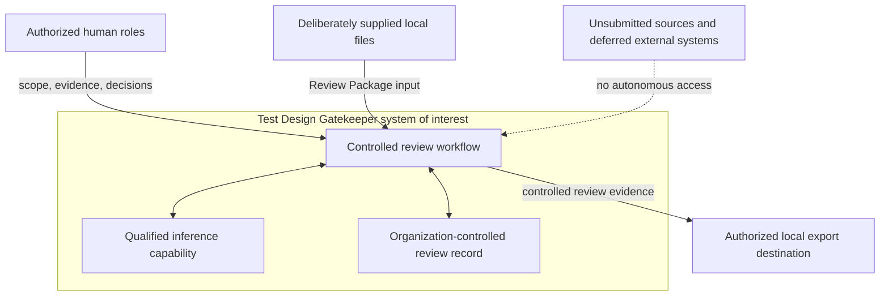
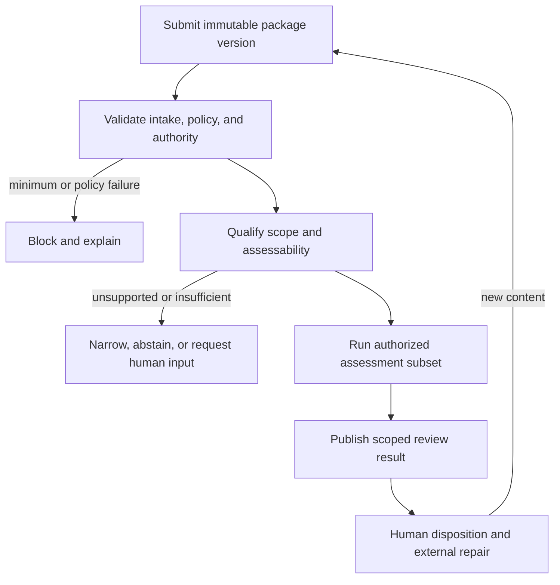

# Test Design Gatekeeper

## RA-02 — System Context, Primary Workflow, Alternate Flows, and Use Cases

| Field | Value |
| --- | --- |
| Basis | Accepted RA-02 v0.3, originally dated 2026-09-12 |
| Original acceptance and gate | Sections 1–22, ten decisions and five review corrections accepted; GO to RA-03 under `PG-RA02-001`, 2026-09-09 |
| Replacement baseline | v0.3 designated on 2026-09-15 in [PG-RA03-001][baseline] |
| Text maintenance | Consolidated on 2026-10-20; section numbers and identifiers retained |
| Decision authority | Project Owner |
| Upstream scope and authority | [Charter v0.4][charter]; [RA-01 v0.3][ra01] |

This is the maintained workflow description. The [original v0.3 text][original] remains in Git history; earlier review hashes and trace ledgers identify that historical snapshot. Later acceptance resolved its candidate labels. The behavior described here is required product behavior, not a claim that it is implemented. See [README.md](../../README.md) for current capability and the development pause.

### v0.3 controlled amendment summary

`CR-RA03-003`, based on the Owner's `OD-RA03-001` decision of 2026-09-12, distinguishes capture/import transformations from assessment mappings. Recapture that changes logical package content creates a new package version; changed assessment behavior against unchanged capture creates a new run. History cannot be overwritten or changed behavior presented as the old run. The reviewed amendment became the baseline on 2026-09-15.

## 1. Purpose

Define TDG's observable boundary, actor goals, bounded pre-review workflow and the situations requiring narrowing, blocking, failure or abstention. [RA-01][ra01] owns role definitions and authority; RA-02 applies them to behavior.

## 2. Scope of RA-02

RA-02 covers system context, actor participation, normal and alternate flows, use cases, lifecycle distinctions, requirements and validation obligations. Detailed contracts belong in RA-03 through RA-10, linked in Section 15. Interface, architecture and implementation choices belong in design; this document grants no implementation or confidential-data permission.

## 3. Source baseline and precedence

The [Charter][charter] governs MVP scope and [RA-01][ra01] governs human authority. Original inputs included the Requirements Analysis Entry Record v0.1 (`RA-IN-002` through `RA-IN-006`, plus `RA-IN-008`) and `PG-RA01-001`, which authorized RA-02. [PG-RA03-001][baseline] records the later accepted `OD-RA03-001` amendment and v0.3 designation.

Use the accepted detailed contracts in Section 15 for the fields, states and rules originally allocated to later workstreams. In particular, [RA-05][ra05] defines result and retry semantics; its [acceptance record][ra05review] resolves the source's historical candidate notice. A conflict with scope or authority requires explicit change control rather than a competing definition here.

## 4. Terminology and object distinctions

| Term | Meaning in RA-02 |
| --- | --- |
| System of interest | TDG treated as a black box with observable responsibilities |
| Review Package | Deliberately supplied scope, basis, cases and provenance for one feature or small process |
| Package version | Immutable identity for exact captured content; changed content requires another version |
| Assessment run | One execution of identified TDG behavior against one exact package version |
| Capture/import transformation | Parsing, import mapping or normalization that establishes captured logical content; changed recapture may create another package version |
| Assessment mapping | Versioned behavior interpreting existing capture; a change requires a new run, not a content version |
| Assessment scope | Items and dimensions supported for review in a particular run |
| Supported subset | Items and dimensions that can be reviewed while exposing exclusions and limitations |
| Substantive assessment | Test-design quality or coverage evaluation after applicable intake, policy, scope and sufficiency checks |
| Review result | Scoped findings, suggestions, limitations, evidence and run metadata |
| Human disposition | ROLE-05 judgment on an item, separate from derivation and testware approval |
| Review cycle | Submission, scope qualification, assessment, human consideration and optional external repair and re-review |
| Re-review | A new run of revised content, or of unchanged content under explicitly identified behavior |
| Fail closed | Refuse the affected action when required authority, policy, verified controls or approved processing are absent |
| External discovery | Retrieval of unsubmitted material; prohibited in MVP review |

These explanations support the workflow. The definitive identities, fields and status vocabulary are in [RA-03][ra03], [RA-04][ra04] and [RA-05][ra05].

## 5. Workflow principles and inherited constraints

Rows marked `INHERITED` apply an approved upstream rule and do not create a second authority source. Rows marked `RA-02` define workflow semantics introduced by this workstream.

| ID | Concise rule | Origin |
| --- | --- | --- |
| WP-01 | One package concerns one declared feature or small process; TDG does not broaden it | RA-02, constrained by Charter Sections 6–7 |
| WP-02 | Qualification precedes every affected substantive assessment | RA-02 |
| WP-03 | Preserve an explicit supported subset where safe; block when a non-separable precondition fails | RA-02 |
| WP-04 | Test level, test type, design basis or technique, and execution mode remain independent axes | RA-02, constrained by Charter Section 9 |
| WP-05 | Supplied fact, interpretation, uncertainty, conflict, and missing support remain distinguishable | INHERITED — RA-01 AP-07 and Charter Section 10 |
| WP-06 | Package-content identity and assessment-behavior identity remain separate and versioned | RA-02 |
| WP-07 | Testware repair remains a human-controlled external loop | INHERITED — RA-01 ROLE-03 and RA01-REQ-006 |
| WP-08 | Machine completion, human disposition, repair, readiness, and approval remain separate milestones | RA-02, constrained by RA-01 AP-05/AP-06 |
| WP-09 | Missing input or capability never permits external discovery or silent fallback | INHERITED — RA-01 AP-07 and Charter Sections 6/13 |
| WP-10 | Every result remains scoped and cannot imply completeness, approval, or ISTQB conformity | INHERITED — Charter Section 10.4 and RA01-REQ-014 |

## 6. System context

### 6.1 Context view

The diagram is logical, not architectural. It does not decide whether a capability is an in-process module, local service, adapter, or another implementation form.

### 6.2 Context entities and boundary participants

| ID | External entity or boundary participant | Relationship with TDG | MVP status |
| --- | --- | --- | --- |
| CTX-01 | Authorized human roles | Supply scope and evidence, operate review, make human decisions, and receive results according to RA-01 authority | REQUIRED |
| CTX-02 | Local import source | Provides deliberately selected canonical JSON and defined CSV-based input without granting access to the surrounding repository | REQUIRED |
| CTX-03 | Organization-controlled review record | Internal TDG responsibility that retains package, run, evidence, finding, disposition, and behavior-version identity under RA-05 persistence rules | REQUIRED |
| CTX-04 | Qualified inference capability | Logical TDG capability, potentially backed by a controlled deployment dependency, that may support only explicitly permitted semantic assessments inside the applicable approved trust boundary | CONDITIONAL |
| CTX-05 | Approved behavior-affecting artifacts | Controlled TDG inputs comprising identified rules, controls, prompts, assessment mappings, model identity, and relevant configuration approved for their role; capture/import transformations remain intake artifacts | REQUIRED WHEN APPLICABLE |
| CTX-06 | Controlled local export destination | Receives an explicitly requested review record under applicable authority and policy | MVP-SUPPORTED DIRECTION |
| CTX-07 | Unsubmitted project documentation, repositories, web sources, or knowledge stores | Must not be searched, inferred as reviewed, or used as hidden evidence | PROHIBITED |
| CTX-08 | Jira, Xray, Zephyr, and other test-management APIs | No direct MVP dependency or write-back; future read-only adapter remains deferred | DEFERRED |
| CTX-09 | External/cloud LLM service | May be used only with public or synthetic data in an explicitly configured laboratory comparison; never as sealed-profile fallback | LABORATORY ONLY |

### 6.3 Boundary summary

TDG is responsible for deliberate local intake, provenance and identity, qualification, authorized assessment, evidence, attributable human interaction, local history and controlled output. It must expose narrowing, blocking, abstention, cancellation and failure.

External discovery, repair of source requirements or test cases, test execution, organizational readiness or approval, ISTQB conformity or certification and guarantees of completeness remain outside its responsibility.

### 6.4 Trust-boundary statement at RA-02 level

Laboratory work uses public or synthetic data only. Sealed use requires an approved boundary, local inference, organization-controlled processing and storage, authorized import and export and fail-closed controls. [RA-08][ra08] defines protection requirements and their verification basis; a workflow description does not establish that these controls exist.

## 7. Inherited actors and RA-02 participation classes

RA-01 defines all roles. ROLE-01 through ROLE-05 participate in the review; ROLE-07 through ROLE-09 support operation, qualification and data policy. ROLE-06 formal approval and ROLE-10 project gates remain external governance. Role combinations and independence limitations follow RA-01.

## 8. Use-case inventory

| Use case | Name | Primary actor | Goal | Classification | Detailed owner |
| --- | --- | --- | --- | --- | --- |
| UC-RA02-001 | Submit a bounded Review Package | ROLE-01 | Deliberately provide one identifiable package version for review | CORE MVP | RA-02; input detail in RA-03/RA-09 |
| UC-RA02-002 | Validate intake and evidence sufficiency | ROLE-01 | Learn whether processing may proceed and what is missing, invalid, conflicting, or conditionally required | CORE MVP | RA-02; detailed rules in RA-03 |
| UC-RA02-003 | Qualify scope and supported assessment subset | ROLE-02 | Establish which items and dimensions are supported, excluded, unclear, or unassessable | CORE MVP | RA-02; detailed classification in RA-04 |
| UC-RA02-004 | Confirm or clarify supplied test-basis interpretation | ROLE-04 | Confirm, correct, reject, or leave unknown a candidate interpretation grounded in supplied evidence | CORE MVP | RA-02; evidence/status detail in RA-05 |
| UC-RA02-005 | Run a bounded test-design review | ROLE-01 | Obtain identified deterministic findings and qualified LLM-assisted suggestions for the supported subset | CORE MVP | RA-02; technique/LLM detail in RA-06/RA-07 |
| UC-RA02-006 | Inspect result, evidence, and limitations | ROLE-01 | Understand what was evaluated, how each item was derived, and what was not established | CORE MVP | RA-02; result model in RA-05 |
| UC-RA02-007 | Disposition an individual finding | ROLE-05 | Accept, reject, defer, or later reopen an item through an attributable human decision | CORE MVP | RA-02; lifecycle/persistence detail in RA-05 |
| UC-RA02-008 | Revise externally and request re-review | ROLE-03 | Change source testware under human control and submit a distinct package version | CORE MVP | RA-02; version model in RA-03/RA-05 |
| UC-RA02-009 | Export a controlled review record | ROLE-01 | Deliberately export scoped evidence and human dispositions without editing source testware or claiming approval | CORE MVP DIRECTION | RA-02; format/policy detail in RA-08/RA-09 |
| UC-RA02-010 | Apply approved operational artifacts | ROLE-07 | Activate an authorized assessment mapping, rule, control, prompt, model reference, or configuration version; apply an authorized capture/import transformation only for a deliberate capture operation | SUPPORTING | Detailed in RA-05/RA-07/RA-09 |
| UC-RA02-011 | Qualify behavior-affecting artifacts | ROLE-08 | Approve or reject identified artifacts for defined assessment roles using controlled evidence | SUPPORTING | Detailed in RA-07/RA-10 |
| UC-RA02-012 | Authorize protected operation | ROLE-09 | Permit or prohibit confidential processing or export under verified sealed-profile controls | FUTURE SEALED PREREQUISITE | Detailed in RA-08 |

Formal testware approval by ROLE-06 and SDLC gate decisions by ROLE-10 are external governance activities, not TDG business use cases in the direct MVP.

### 8.1 Actor-to-use-case participation

The inventory identifies each primary actor; the core contracts below identify supporting decisions. Participation grants no additional authority. Apply [RA-01's authority matrix][ra01], including the distinction between ROLE-07 applying an approved artifact, ROLE-08 qualifying it and ROLE-09 authorizing protected use. ROLE-06 and ROLE-10 decisions remain outside direct MVP business use cases.

## 9. Primary pre-review workflow

### 9.1 Preconditions

ROLE-01 and the acting decision roles are identified at least through laboratory actor identifiers; sealed use requires verified identity. The operating profile is known, input is deliberately selected locally, and data policy permits intake. Laboratory material must be public or synthetic. Only behavior artifacts approved for the intended review roles may be used. These runtime preconditions do not authorize implementation or establish protected-use readiness.

### 9.2 Trigger

ROLE-01 deliberately submits a package candidate and requests pre-review under an identified profile and assessment configuration.

### 9.3 Nominal flow

| Step | Actor | Observable responsibility |
| --- | --- | --- |
| PWF-01 | ROLE-01 | Selects or supplies one local Review Package candidate and declares the intended review request |
| PWF-02 | TDG | Creates an identifiable submission context without modifying the source artifacts |
| PWF-03 | TDG | Validates the applicable input structure, minimum admissibility, operating-profile policy, and required authority context |
| PWF-04 | TDG | Reports detected invalid, missing, conflicting, unmapped, or policy-blocked conditions before relying on affected content |
| PWF-05 | TDG | Identifies the exact package version, supplied provenance, declared scope, test-basis elements, and associated test cases available for qualification |
| PWF-06 | TDG | Analyzes test level, test type, design basis, execution mode, scope match, and assessability as distinct dimensions |
| PWF-07 | ROLE-02 | Confirms the declared package boundary when confirmation or a deliberate scope decision is required |
| PWF-08 | ROLE-04 | Confirms, corrects, rejects, or leaves unknown a supplied-rule interpretation when an assessment depends on human confirmation |
| PWF-09 | TDG | Defines and exposes the supported subset and explicitly excludes, narrows, or abstains on unsupported dimensions |
| PWF-10 | TDG | Creates a new assessment-run identity tied to the exact package and relevant behavior-artifact versions |
| PWF-11 | TDG | Executes applicable deterministic controls against sufficiently confirmed structured evidence |
| PWF-12 | TDG | Invokes only a qualified LLM role through an authorized processing path when semantic assistance is applicable |
| PWF-13 | TDG | Produces scoped findings, suggestions, limitations, abstentions, and evidence without assigning human disposition |
| PWF-14 | TDG | Makes the result available with evaluated and unevaluated scope, derivation, uncertainty, provenance, and version context visible |
| PWF-15 | ROLE-01 / ROLE-05 | Inspects the result; ROLE-05 accepts, rejects, or defers individual items where desired and authorized |
| PWF-16 | TDG | Records each human decision, acting role, applicable self-review label, rationale under later-defined rules, and history without converting it into testware approval |
| PWF-17 | ROLE-03 | Decides whether and how to change the source testware outside autonomous TDG control |
| PWF-18 | ROLE-03 / ROLE-02 / ROLE-01 | ROLE-03 owns testware changes, ROLE-02 approves any boundary change, and ROLE-01 deliberately submits a distinct package version for another assessment cycle |

Steps involving ROLE-02, ROLE-04, and ROLE-05 may be performed by the same human when RA-01 permits the role combination. TDG must still record which role authorizes each decision and any self-review or independence limitation.

### 9.4 Workflow view

### 9.5 Nominal postconditions

Sources remain unchanged; package and run identities, evaluated and omitted scope, limitations and evidence remain visible. New items start `PENDING`; human dispositions are attributable and separate from derivation, editing and approval. Zero supported findings carries an explicit non-completeness statement. Changed content requires a new version. No unsubmitted evidence, unapproved service or silent fallback may be used.

### 9.6 Completion distinctions

Intake does not establish admissibility or scope. Qualification does not mean every item is supported or every rule confirmed. An available assessment result does not mean human acceptance or repair. Recorded human review does not mean formal approval. A later package version does not permit erasing earlier evidence. [RA-05][ra05] defines the separate state and availability contracts.

## 10. Alternate, exception, and recovery flows

The outcome column describes workflow meaning, not a competing status enum. Apply [RA-03][ra03] through [RA-05][ra05] for exact conditions, precedence and retained records. AF-RA02-016 now states RA-05's accepted terminal-run rule directly instead of leaving possible resumption unspecified.

| Flow | Trigger or condition | Required TDG behavior | Human authority or action | Conceptual outcome |
| --- | --- | --- | --- | --- |
| AF-RA02-001 | Input cannot be parsed or a required capture/import transformation is invalid | Identify the file, location or field where feasible; do not silently discard assessment-relevant content | ROLE-01 corrects input or supplies an approved capture/import path | Intake rejected or restricted |
| AF-RA02-002 | Minimum admissible package content is absent | Identify missing minimum elements and stop substantive review of the package | ROLE-02/ROLE-03 supplies a deliberate new version | Ungradable intake |
| AF-RA02-003 | Optional or technique-specific evidence is absent | Identify affected dimensions; continue only with independent supported assessments | Human may add evidence or accept the limitation | Partial assessability |
| AF-RA02-004 | Supplied sources contradict one another | Preserve competing evidence and source identity; do not choose a rule without authorized human basis | ROLE-04 resolves, establishes precedence, or leaves the conflict open | Conflicting basis or narrowed review |
| AF-RA02-005 | Test cases do not match the declared feature or process | Identify the mismatch and avoid treating unrelated cases as coverage | ROLE-02 confirms boundary or submits corrected content | Scope mismatch |
| AF-RA02-006 | Package contains both supported and unsupported items | Isolate item-level outcomes and prevent unsupported items from being counted as evaluated | ROLE-02 may narrow or deliberately revise the package | Supported subset plus explicit exclusions |
| AF-RA02-007 | Classification evidence is ambiguous or mixed | Describe the observed external/internal basis and uncertainty; do not force “gray-box” as a definitive verdict | Authorized human may clarify supplied context | Human review required or undetermined classification |
| AF-RA02-008 | Item relies on internal structure or white-box coverage outside MVP | Identify the observed basis and abstain from white-box coverage review | Human may remove it from scope or retain it as explicitly unevaluated | Out-of-scope assessment item |
| AF-RA02-009 | Item is labeled unit, integration, acceptance, manual, or automated | Evaluate independent classification axes; never infer black-box/white-box solely from the label | Human may clarify evidence and intended level | Supported, unsupported, mixed, or undetermined based on evidence |
| AF-RA02-010 | Required human role or acting authority is absent | Permit only actions that need no missing authority; block the authority-bearing action and explain the required role | An authorized human assumes the role or the action remains pending | Authority-blocked action |
| AF-RA02-011 | No separate domain expert is available | Preserve combined-role operation, uncertainty, conflict, and escalation; never auto-confirm LLM interpretation | Explicitly assigned ROLE-04 acts within competence or leaves unknown | Confirmed by human, unknown, conflicting, or escalated |
| AF-RA02-012 | A review request depends on an LLM role or behavior version not qualified for user-reliance review | Do not use it for that review or substitute another model silently; allow independent deterministic assessments when valid | ROLE-08 may evaluate and later qualify an identified version through the segregated qualification use case | Partial assessment or unavailable dimension |
| AF-RA02-013 | Approved local inference path becomes unavailable | Fail closed for LLM-dependent sealed processing; never fall back to cloud | ROLE-07 may restore an approved path; ROLE-09 controls any policy change | Interrupted or partial assessment |
| AF-RA02-014 | Confidential or possibly protected material is presented in laboratory profile | Stop before prohibited substantive processing and clearly state the profile restriction | ROLE-09 cannot waive laboratory restrictions ad hoc; later sealed prerequisites must be satisfied | Policy-blocked intake |
| AF-RA02-015 | Supplied content changes after assessment begins | Continue only against the immutable submitted snapshot or cancel it; never merge changed content silently | ROLE-03/ROLE-02 submits a distinct version | Original run remains attributable; new cycle required |
| AF-RA02-016 | User cancels or a technical failure interrupts processing | Preserve the original input; record interruption and any safely committed evidence; never present partial work as complete | ROLE-01 may initiate a new run; a terminal run cannot resume, as defined in RA-05 Section 3.1 | Cancelled or failed run |
| AF-RA02-017 | Unchanged package version is assessed again | Create a distinct run identity and record behavior/configuration identity; do not overwrite prior results | ROLE-01 requests rerun | Comparable assessment runs |
| AF-RA02-018 | A new package version is submitted after external repair | Link lineage without treating prior findings as silently resolved; determine affected disposition handling later | ROLE-03 owns changes; ROLE-05 reconsiders affected findings | Versioned re-review |
| AF-RA02-019 | No supported finding is detected | Report the evaluated scope and limitations with an explicit non-completeness statement | Human decides what to do next | Scoped no-supported-finding result |
| AF-RA02-020 | Export is unauthorized, unsafe, or targets a prohibited destination | Block export, preserve the local review record, and record the denied attempt as later policy requires | ROLE-09 or applicable policy controls authorization | Export denied; review evidence unchanged |
| AF-RA02-021 | Package spans multiple unrelated features or an oversized cross-process/E2E flow beyond the approved unit of review | Identify the boundary problem and do not silently aggregate it into one apparently complete assessment | ROLE-02 narrows and deliberately resubmits one or more bounded packages | Out-of-scope or scope-revision-required package |
| AF-RA02-022 | Test cases are designed to evaluate an AI/LLM system or another deliberately excluded application domain | Identify the excluded target domain and abstain from the unsupported domain-specific review while preserving any independently valid intake evidence | Human removes, separates, or retains the items as explicitly unevaluated | Parked-extension or out-of-scope items |

No alternate flow permits source repair, testware approval, external discovery, invented rules or concealed non-performance.

## 11. Core use-case specifications

These contracts describe observable behavior. Actors retain only their RA-01 authority; neither interface nor component design is selected here.

### UC-RA02-001 — Submit a bounded Review Package

ROLE-01 deliberately selects local input and requests review under a known profile and actor context. Data policy must permit intake; ROLE-02 owns the declared boundary and ROLE-09 policy applies where relevant. TDG creates an identifiable package snapshot or attributable rejection without modifying sources. Show source identity, scope, available provenance, package-version identity and detected limitations. Submission neither confirms source correctness nor widens scope or grants another role.

Alternate flows: AF-RA02-001, AF-RA02-002, AF-RA02-014 and AF-RA02-015.

### UC-RA02-002 — Validate intake and evidence sufficiency

An identifiable candidate must be examinable through an authorized path. ROLE-01 sees what is missing, invalid, conflicting or unmapped and which processing is affected. ROLE-02 supports scope, ROLE-04 interpretation and ROLE-07 issues with approved capture or import. Distinguish missing minimum content, conditional gaps, contradictions, format problems and policy blocks. TDG may request human context but cannot retrieve or invent it.

Alternate flows: AF-RA02-001 through AF-RA02-004, AF-RA02-010 and AF-RA02-014.

### UC-RA02-003 — Qualify scope and supported assessment subset

After intake permits qualification, TDG needs identifiable scope, basis and associated cases sufficient for that classification. ROLE-01 operates; ROLE-02 owns boundary decisions. Expose supported, unsupported, mixed, mismatched and undetermined items and dimensions without forced classification. Keep level, type, design basis, technique evidence and execution mode separate. TDG may recommend narrowing; ROLE-02 decides scope changes.

Alternate flows: AF-RA02-003 and AF-RA02-005 through AF-RA02-009.

### UC-RA02-004 — Confirm or clarify supplied test-basis interpretation

When an assessment needs human confirmation, present the candidate interpretation with its supplied evidence and source identity. ROLE-04 may confirm, correct, reject or leave it unknown; retain the decision and acting role. Distinguish facts, interpretation, evidence, uncertainty, conflicts, response and affected assessment. A missing expert never permits LLM self-confirmation; rule confirmation does not disposition findings or approve testware.

Alternate flows: AF-RA02-004, AF-RA02-010 and AF-RA02-011.

### UC-RA02-005 — Run a bounded test-design review

ROLE-01 requests assessment of the exposed supported subset. The exact package, scope and behavior artifacts must be identifiable and authorized, including ROLE-08 qualification, ROLE-07 activation and applicable ROLE-09 policy. Produce a scoped result or an explicit partial, ungradable, blocked, cancelled or failed outcome under RA-05. Distinguish deterministic findings from qualified LLM suggestions; no silent substitution. New items remain `PENDING`; TDG cannot accept its findings, repair or approve testware, or claim completeness.

Alternate flows: AF-RA02-003, AF-RA02-004, AF-RA02-006 through AF-RA02-016 and AF-RA02-019.

### UC-RA02-006 — Inspect result, evidence, and limitations

When a result or explicit non-success outcome exists, ROLE-01 and other permitted viewers in ROLE-02 through ROLE-05 may inspect it under access policy. Show evaluated, unevaluated and blocked parts; package and run identity; review dimension; derivation; supporting source evidence; inference and uncertainty; limitations; disposition; and relevant behavior versions. Viewing grants no disposition, editing, export, qualification or approval right.

Alternate flows: access denial under RA-01 and AF-RA02-019.

### UC-RA02-007 — Disposition an individual finding

ROLE-05 chooses to judge a `PENDING` item or reconsider an affected decision. The finding, evidence, package and run identity and acting human role must be available. Add an allowed disposition and attributable rationale without changing derivation or source testware. Mark author review as self-review. Reopening preserves history and follows RA-05's human decision rules; version changes cannot reopen items automatically. A disposition establishes neither completeness, readiness, approval nor ISTQB conformity.

Alternate flows: AF-RA02-010, AF-RA02-017 and AF-RA02-018.

### UC-RA02-008 — Revise externally and request re-review

The human controls the edited source; the earlier package and review history remain identifiable. ROLE-03 owns testware changes, ROLE-02 approves scope changes and ROLE-01 may submit. Revised testware or supplied basis enters as a distinct package version with lineage; earlier review remains intact. Distinguish new content from another assessment of unchanged content. TDG may describe a gap but cannot write, apply or publish the source change.

Alternate flows: AF-RA02-015, AF-RA02-017 and AF-RA02-018.

### UC-RA02-009 — Export a controlled review record

ROLE-01 explicitly requests an identified record export. Data, destination, profile and actor must be authorized; ROLE-09 authority is required where protected data or organizational policy demands it. Produce an attributable local export or clear denial without changing the canonical record. Keep evidence, TDG output, human dispositions, limitations and package/run versions distinguishable; reproduce ROLE-05 decisions accurately and include a non-approval statement. Export cannot edit testware, write back to Jira/Xray/Zephyr or issue formal approval.

Alternate flow: AF-RA02-020.

### 11.1 Supporting use-case boundary

UC-RA02-010 through UC-RA02-012 supply approved artifacts, qualification and protected-use policy. Their detailed conditions are in [RA-05][ra05], [RA-07][ra07], [RA-08][ra08], [RA-09][ra09] and [RA-10][ra10].

## 12. Lifecycle separation and version semantics

### 12.1 Objects that must not be collapsed

Keep package versions, assessment runs, derived findings, human disposition events and export instances distinct. [RA-03][ra03] defines capture identity and [RA-05][ra05] defines assessment records. ROLE-02 owns scope; ROLE-03 owns edits; ROLE-01 requests runs and exports under applicable controls; ROLE-05 decides findings. Formal organizational approval remains a separate ROLE-06 decision outside direct MVP authority.

### 12.2 Required cross-object relationships

- One package version may have multiple assessment runs.
- One assessment run evaluates exactly one immutable package version.
- One run may contain multiple findings, suggestions, limitations, and item-level outcomes.
- Every finding belongs to one originating run and one supported assessment context.
- One finding may accumulate a controlled disposition history; the latest applicable disposition must not erase its predecessors.
- A new package version does not silently resolve a finding from an older version.
- A behavior change does not mutate an old run; it produces a new run if reassessment occurs.
- An export represents identified record state and does not become the canonical source of truth by itself.

### 12.3 Version-impact principle

Make changes and their consequences visible. A capture/import transformation that recaptures a different logical projection creates a new package version. An assessment mapping or other behavior-artifact change against unchanged capture requires a new run. Never overwrite history, silently reuse obsolete results or present materially changed behavior as the same assessment.

[RA-05][ra05] governs reopening and comparison; [RA-07][ra07] governs qualification; [RA-09][ra09] governs physical import. RA-05 also distinguishes first human confirmation within an eligible active run from replacing an already applied interpretation. It never permits resuming a terminal run or changing configured behavior in that run.

## 13. Workflow outcome classes

Keep processing state, individual assessment outcome, result availability and human disposition separate. The definitive contracts are [RA-05 Sections 3 and 5][ra05]; the early conceptual outcome names are not additional product statuses.

Missing or conflicting evidence differs from no findings; unavailable capability differs from a technical failure; policy or authority blocking differs from a quality judgment; cancellation differs from completion. A partial result must expose excluded or unassessable items and dimensions. Summaries cannot conceal ungradable, conflicting, unsupported or blocked parts. An available result or zero findings proves neither completeness nor approval. Recorded decisions do not prove repair, and requesting re-review does not close older evidence.

## 14. Accepted RA-02 requirements

All thirty-six requirements retain their exact wording, `MUST` priorities, status and source traces below. The Owner accepted RA-02 on 2026-09-09, including the reviewed clarifications to REQ-005, REQ-020 and REQ-026 under `SR-RA02-F-002` and `SR-RA02-F-004`. The later `OD-RA03-001` terminology clarification to REQ-018 was reviewed and included in the v0.3 baseline designated on 2026-09-15.

| ID | Requirement | Priority | Status | Primary source |
| --- | --- | --- | --- | --- |
| RA02-REQ-001 | TDG shall treat one immutable Review Package version concerning one declared feature or small business process as the input unit for one assessment run | MUST | ACCEPTED | Charter Sections 6–7; WP-01; Section 12 |
| RA02-REQ-002 | TDG shall base review behavior only on material deliberately supplied in the identified Review Package and approved behavior artifacts | MUST | ACCEPTED | RA-IN-005; AP-07; WP-05 |
| RA02-REQ-003 | TDG shall not search unsubmitted repositories, project documentation, web sources, Jira, Xray, Zephyr, or other external systems during MVP review | MUST | ACCEPTED | Charter Sections 11–12; CTX-07/08 |
| RA02-REQ-004 | TDG shall not modify, overwrite, or publish changes to supplied source testware | MUST | ACCEPTED | RA01-REQ-006; WP-07 |
| RA02-REQ-005 | TDG shall preserve the RA-01 distinction among operator, scope, test-basis, finding-disposition, testware-editing, qualification, security, and approval authority in workflow behavior, records, and outputs; logical attribution in the laboratory shall not be represented as sealed-profile access-control enforcement | MUST | ACCEPTED | RA-01 AP-01 through AP-06; OD-RA01-003 |
| RA02-REQ-006 | TDG shall identify the applicable operating profile and block processing that the profile or recorded policy does not permit | MUST | ACCEPTED | RA01-REQ-011; Section 6.4 |
| RA02-REQ-007 | TDG shall perform applicable structural, policy, authority, scope, and sufficiency checks before presenting an affected substantive assessment as supported | MUST | ACCEPTED | Charter Section 9; WP-02 |
| RA02-REQ-008 | When minimum package admissibility is not met, TDG shall identify the missing minimum elements and shall not perform substantive package review | MUST | ACCEPTED | RA-IN-002; AF-RA02-002 |
| RA02-REQ-009 | Missing optional or assessment-specific evidence shall limit only the affected item or assessment dimension when an independent supported subset remains safe and meaningful | MUST | ACCEPTED | Charter Section 7; WP-03; AF-RA02-003 |
| RA02-REQ-010 | TDG shall identify malformed, unknown, or unmapped assessment-relevant input without silently discarding it | MUST | ACCEPTED | Charter Section 12.2; AF-RA02-001 |
| RA02-REQ-011 | TDG shall analyze test level, test type, test-design basis, test technique, and execution mode as distinct classification dimensions | MUST | ACCEPTED | Charter Section 9; RA-IN-003; WP-04 |
| RA02-REQ-012 | TDG shall not classify an item as black-box, white-box, in-scope, or out-of-scope solely because it is labeled unit, component, integration, system, acceptance, manual, or automated | MUST | ACCEPTED | Charter Section 9; AF-RA02-009 |
| RA02-REQ-013 | TDG shall support item-level and assessment-dimension outcomes for supported, unsupported, mixed, mismatched, insufficient, conflicting, and undetermined evidence | MUST | ACCEPTED | RA-IN-002/003; UC-RA02-003 |
| RA02-REQ-014 | For a mixed package, TDG shall isolate a supported subset where safe and shall explicitly identify every excluded or unassessable item and dimension | MUST | ACCEPTED | WP-03; AF-RA02-006 |
| RA02-REQ-015 | TDG shall make mismatch between the declared business boundary and supplied test cases visible and shall not count mismatched cases as coverage | MUST | ACCEPTED | Charter Sections 8–9; AF-RA02-005 |
| RA02-REQ-016 | TDG shall preserve contradictory supplied evidence and shall not resolve source precedence or confirm a business rule without an identified ROLE-04 human decision | MUST | ACCEPTED | RA01-REQ-005; AF-RA02-004 |
| RA02-REQ-017 | Each assessment run shall have a distinct identity and shall reference exactly one immutable Review Package version | MUST | ACCEPTED | WP-06; Section 12 |
| RA02-REQ-018 | Each assessment run shall identify the rules, assessment mappings, deterministic controls, prompts, model, and relevant configuration versions that materially affected its behavior; the capture/import transformation that established its referenced package version shall remain separately identifiable | MUST | ACCEPTED | RA-IN-004/008; RA01-REQ-015; `OD-RA03-001` |
| RA02-REQ-019 | TDG shall execute a deterministic coverage claim only when its required structured rule evidence is sufficiently confirmed and traceable | MUST | ACCEPTED | Charter Section 10.1; PWF-11 |
| RA02-REQ-020 | For a review result intended for user reliance, TDG shall invoke an LLM only for an explicitly permitted role using an identified version qualified for that role and an authorized processing path; controlled qualification or evaluation may invoke an unqualified candidate only in a segregated evaluation context whose output cannot be represented as a qualified review result | MUST | ACCEPTED | Charter Sections 10.2 and 17; RA01-REQ-010; UC-RA02-011 |
| RA02-REQ-021 | When an LLM role is unavailable, unqualified, or prohibited, TDG shall not silently substitute another model or external service; independent supported assessments may continue only with an explicit partial-result limitation | MUST | ACCEPTED | WP-09; AF-RA02-012/013 |
| RA02-REQ-022 | A review result shall identify the package version, assessment run, evaluated and unevaluated scope, derivation, evidence, inference, uncertainty, limitations, and applicable behavior versions | MUST | ACCEPTED | Charter Section 10; UC-RA02-006 |
| RA02-REQ-023 | Every newly derived finding or suggestion shall begin with human disposition `PENDING` and shall remain separate from its derivation | MUST | ACCEPTED | Charter Section 10; RA01-REQ-008 |
| RA02-REQ-024 | A result with no supported finding shall state its evaluated boundary and shall not claim suite completeness, testware approval, or ISTQB conformity | MUST | ACCEPTED | Charter Section 10.4; WP-10; AF-RA02-019 |
| RA02-REQ-025 | TDG shall allow an authorized viewer to inspect the evidence, derivation, uncertainty, limitations, disposition, and version context needed to review an item | MUST | ACCEPTED | UC-RA02-006; RA01-REQ-007 |
| RA02-REQ-026 | For every scope change, rule confirmation, finding disposition, behavior qualification, or protected-data authorization performed or recorded through TDG, TDG shall require the applicable identified human role without demanding duplicate confirmation when the same explicit, valid decision is already recorded for unchanged scope; TDG shall not perform external source-testware editing, formal testware approval, or SDLC phase-gate decisions | MUST | ACCEPTED | RA-01 AUTH-02/04/05/06/08/10/11/14; OD-RA02-009 |
| RA02-REQ-027 | When the testware author dispositions findings, TDG shall persistently identify the activity as self-review and shall not represent it as independent review | MUST | ACCEPTED | OD-RA01-001; RA01-REQ-013 |
| RA02-REQ-028 | TDG shall permit an authorized revised package submission while earlier findings remain pending or deferred, and any change to supplied content or declared scope shall enter as a distinct package version linked to prior lineage rather than altering an assessed snapshot or silently resolving prior items | MUST | ACCEPTED | AP-07; WP-06/07; AF-RA02-015/018; OD-RA02-010 |
| RA02-REQ-029 | Reassessment of an unchanged package version shall create a distinct assessment run and shall preserve all earlier run results | MUST | ACCEPTED | WP-06; AF-RA02-017 |
| RA02-REQ-030 | TDG shall preserve prior finding and disposition history and shall make version impact visible without silently treating an older finding as resolved | MUST | ACCEPTED | RA-IN-004; Section 12.3 |
| RA02-REQ-031 | TDG shall support a deliberate, policy-controlled local export of an identified review record without modifying source testware, writing back to test-management systems, or issuing formal approval | MUST | ACCEPTED | UC-RA02-009; Charter Section 12.3 |
| RA02-REQ-032 | On cancellation or technical failure, TDG shall preserve source input, distinguish incomplete processing from a completed review, and retain any safely committed diagnostic evidence under later-defined rules | MUST | ACCEPTED | AF-RA02-016 |
| RA02-REQ-033 | TDG shall distinguish intake, qualification, assessment-result availability, human review activity, external testware repair, and formal approval as separate milestones | MUST | ACCEPTED | WP-08; Section 9.6 |
| RA02-REQ-034 | TDG shall not perform or publish formal organizational testware approval in the direct MVP workflow | MUST | ACCEPTED | OD-RA01-004; RA01-REQ-016 |
| RA02-REQ-035 | TDG shall identify a package that exceeds the approved one-feature-or-small-process unit of review and shall require human narrowing rather than silently treating an oversized cross-process flow as one supported package | MUST | ACCEPTED | Charter Sections 6–8; AF-RA02-021 |
| RA02-REQ-036 | TDG shall identify test cases designed for AI/LLM systems or another deliberately excluded target domain as unsupported by the MVP domain capability and shall not perform the parked domain-specific review | MUST | ACCEPTED | Charter Section 11; RA02-AC-008; AF-RA02-022 |

`MUST` preserves the accepted concept, authority and workflow. It neither selects implementation technology nor grants implementation permission. Later reprioritization requires controlled change and impact analysis.

## 15. Allocation to later Requirements Analysis workstreams

These allocations now point to accepted requirements. They avoid repeating detailed rules here; acceptance does not establish implemented capability.

| Source | Governing detail |
| --- | --- |
| [RA-03 — Review Package][ra03] | Minimum and conditional content, scope, provenance, capture, identifiers, immutability and lineage |
| [RA-04 — Scope qualification][ra04] | Independent classification axes, criteria, uncertainty, mixed evidence, separability and supported subsets |
| [RA-05 — Findings and persistence][ra05] | Run, finding and disposition identities; statuses, evidence, history, reopening, comparison and persistence |
| [RA-06 — Four techniques][ra06] | Applicability, coverage rules, deterministic assessment and evidence for EP, BVA, decision tables and state transitions |
| [RA-07 — LLM roles][ra07] | Permitted tasks, grounding, abstention, model and prompt identity, qualification, requalification and change impact |
| [RA-08 — Security and privacy][ra08] | Classification, trust boundary, access, processing, logs, temporary data, retention, deletion, export and fail-closed controls |
| [RA-09 — Input and export][ra09] | JSON and CSV contracts, transformations, errors, preservation, round-trip rules, export and deferred adapters |
| [RA-10 — Evaluation and acceptance][ra10] | Dataset coverage, human oracle, thresholds, metrics, usability, effort, robustness and acceptance |

Later detail must preserve RA-01 authority and RA-02 workflow and supplied-data boundaries unless an explicit approved change replaces them. The [requirements readiness record][readiness] records the completed acceptance baseline.

## 16. Downstream validation obligations

These twenty obligations guide test analysis; they are not executable cases or proof of passed tests. Their exact wording and traces are retained.

| ID | Verification objective | Principal test-design direction | Primary trace |
| --- | --- | --- | --- |
| RA02-VAL-001 | Demonstrate the complete nominal path from deliberate package submission through scoped result, human disposition, external repair, and versioned re-review | End-to-end business workflow scenario | PWF-01 through PWF-18 |
| RA02-VAL-002 | Verify that malformed input and invalid capture/import transformations are reported without silent field loss or source modification | Negative input validation and data-integrity tests | AF-RA02-001; RA02-REQ-004/010 |
| RA02-VAL-003 | Verify that each missing minimum element prevents substantive package review and identifies the human repair needed | Decision table plus negative tests | AF-RA02-002; RA02-REQ-008 |
| RA02-VAL-004 | Verify that missing conditional evidence restricts only dependent assessments while independent supported checks remain clearly scoped | Decision table and pairwise evidence combinations | AF-RA02-003; RA02-REQ-009 |
| RA02-VAL-005 | Verify that contradictory sources remain visible and no precedence or rule is selected without ROLE-04 | Negative authority and evidence tests | AF-RA02-004; RA02-REQ-016 |
| RA02-VAL-006 | Verify that mismatched test cases are not counted as coverage for the declared process | Traceability and negative scope tests | AF-RA02-005; RA02-REQ-015 |
| RA02-VAL-007 | Verify item-level outcomes for packages mixing supported system-functional black-box tests with unit, integration, acceptance, non-functional, white-box, or automated artifacts | Classification decision tables using difficult mixed packages | RA-IN-003; AF-RA02-006 through 009 |
| RA02-VAL-008 | Verify that unit, integration, system, acceptance, manual, and automated labels never determine the black-box/white-box verdict by themselves | Metamorphic label-change and negative classification tests | WP-04; RA02-REQ-011/012 |
| RA02-VAL-009 | Verify permitted and denied actions for every authority-bearing workflow step, including combined-role acting-role attribution, laboratory logical roles, and later sealed-profile enforcement without representing them as equivalent assurance | Role/authority decision table and negative authorization tests | RA-01 AUTH-01 through AUTH-14; RA02-REQ-005/026 |
| RA02-VAL-010 | Verify that absence of a separate domain expert yields human `UNKNOWN`, conflict, or escalation rather than LLM self-confirmation | Negative misuse and human-authority tests | AF-RA02-011; UC-RA02-004 |
| RA02-VAL-011 | Verify deterministic-only continuation and explicit partial outcome when an LLM role is unavailable or unqualified, absence of silent substitution, and segregation of unqualified candidate execution from user-reliance review | Capability decision table, controlled failure injection, and qualification-boundary tests | AF-RA02-012/013; RA02-REQ-019 through 021 |
| RA02-VAL-012 | Verify that public/synthetic laboratory input is allowed while confidential or possibly protected input is blocked before prohibited processing | Data-classification decision table and fail-closed security tests | AF-RA02-014; RA02-REQ-006 |
| RA02-VAL-013 | Verify immutability of an assessed package and creation of a distinct version after any relevant content or scope change | State-transition and integrity tests | AF-RA02-015/018; RA02-REQ-028 |
| RA02-VAL-014 | Verify that repeated assessment of unchanged content creates a distinct run tied to behavior versions and preserves earlier results | State-transition and history-comparison tests | AF-RA02-017; RA02-REQ-017/018/029 |
| RA02-VAL-015 | Verify `PENDING` initialization, authorized disposition, persistent `SELF_REVIEW`, and version-impact reopening without derivation changes | Finding/disposition state-transition tests | UC-RA02-007; RA02-REQ-023/027/030 |
| RA02-VAL-016 | Verify that zero findings always carries evaluated-scope and non-completeness language and never yields approval or ISTQB-conformity text | Output-contract and prohibited-claim tests | AF-RA02-019; RA02-REQ-024/034 |
| RA02-VAL-017 | Verify that cancellation and technical failure preserve source data and cannot appear as a completed assessment | Failure injection, recovery, and state-transition tests | AF-RA02-016; RA02-REQ-032/033 |
| RA02-VAL-018 | Verify authorized local export and denied-export behavior, record immutability, provenance, no testware mutation, and no test-management write-back | Authorization decision table and output-contract tests | UC-RA02-009; AF-RA02-020; RA02-REQ-031 |
| RA02-VAL-019 | Verify rejection or human-directed partitioning of oversized multi-feature and cross-process/E2E packages without misleading aggregated review | Scope-boundary partitions and negative workflow tests | AF-RA02-021; RA02-REQ-001/035 |
| RA02-VAL-020 | Verify that tests targeting AI/LLM systems and other parked domains are classified as unsupported without invoking domain-specific review | Negative target-domain qualification tests | AF-RA02-022; RA02-REQ-036 |

Include difficult cases whose labels and evidence disagree; nominal happy paths alone cannot validate the workflow.

## 17. Decision disposition record

The Owner accepted all ten decisions on 2026-09-09. No RA-02 workflow policy decision remains open.

### OD-RA02-001 — May a mixed package receive a partial review?

**Yes, if a safe supported subset can be isolated.** Show unsupported or unassessable items; do not count them toward a full-package score or imply completeness. Non-separable minimum or policy failures block the affected whole operation.

### OD-RA02-002 — Should insufficient evidence be decided for the whole package or per assessment?

**Use the narrowest defensible level.** Prefer item and dimension limits. Use a package-wide inability to review only when minimum admissibility, trusted processing or every meaningful assessment is affected.

### OD-RA02-003 — Must every extracted rule be human-confirmed before any TDG check runs?

**No; authority must match the claim.** Structural and other checks independent of disputed rules may proceed. Deterministic coverage needs sufficiently confirmed, traceable structured rules. Unconfirmed interpretation supports only a grounded uncertain suggestion or abstention, never self-confirmation.

### OD-RA02-004 — Is a submitted package version immutable once an assessment begins?

**Yes.** Sources remain human-owned; relevant content or scope changes create another version with lineage. The assessed snapshot cannot change.

### OD-RA02-005 — Is a rerun of unchanged content a new assessment run?

**Yes, always.** Preserve earlier results and record behavior identity so runs can be compared.

### OD-RA02-006 — When is the pre-review “complete”?

**Keep milestones separate.** Processing completion, result availability, human decisions, external repair and readiness for later human review are different events. [RA-05][ra05] defines their states; `COMPLETED` cannot imply all of them.

### OD-RA02-007 — What happens when an LLM-dependent capability is unavailable?

**Continue only independent supported assessments with explicit partial-result limits.** Never switch silently. Sealed LLM-dependent work fails closed when approved local inference is lost. A laboratory model change also needs identified configuration and a new run.

### OD-RA02-008 — Is local review-record export part of the MVP?

**Yes, under policy.** Preserve scope, evidence, derivation, limitations, dispositions and versions. No source editing, test-management write-back or formal approval. [RA-08][ra08] and [RA-09][ra09] define policy and format.

### OD-RA02-009 — Must ROLE-02 reconfirm scope on every nominal submission?

**No, when the explicit boundary and valid authority are already recorded.** A submitting ROLE-01 who also holds ROLE-02 may record that decision with the submission. Separate confirmation is needed when scope authority is missing, scope is absent or ambiguous, or narrowing or a change needs approval.

### OD-RA02-010 — Must all findings be dispositioned before a revised package can be submitted?

**No.** Earlier items may remain `PENDING` or `DEFERRED`. Preserve their states and lineage, and expose impact without silently accepting, rejecting or resolving them.

## 18. Assumptions and constraints requiring preservation

| ID | Constraint | Governing detail |
| --- | --- | --- |
| RA02-AC-001 | One feature or small business process per package | RA-03; no implicit scope expansion |
| RA02-AC-002 | Laboratory data is public or synthetic | RA-08; protected use needs approved, verified sealed controls |
| RA02-AC-003 | Canonical JSON and defined CSV are the MVP input direction | RA-09 schema and transformations |
| RA02-AC-004 | Local persistence is required | RA-05 defines semantics; storage technology belongs to design, not RA-02 |
| RA02-AC-005 | Qualified LLM assistance cannot be final authority or an automatic fallback | RA-07 roles and qualification |
| RA02-AC-006 | Workflow descriptions are not the definitive status schema | RA-05 defines the accepted vocabulary and state model |
| RA02-AC-007 | Direct Jira/Xray/Zephyr integration and all write-back are outside MVP | Future read-only adapter remains deferred |
| RA02-AC-008 | Reviewing tests of AI/LLM systems remains outside MVP | Deferred product extension; no domain expansion |

## 19. Static quality check and review state

The original RA-02 record reports `SR-RA02-001` closed with five corrected and verified findings: one High, three Medium and one Low. The corrections addressed duplicated RA-01 content (`RA02-REV-001`), qualification circularity, mixed project/runtime preconditions, laboratory-versus-sealed authority and overly broad export authority. The Owner accepted the corrective actions, including `SR-RA02-F-002` through `SR-RA02-F-005`, on 2026-09-09. The reviewer helped draft the document; this was not independent assurance.

The later `SR-RA03-001` accepted `CR-RA03-003`, and [PG-RA03-001][baseline] designated v0.3. These are historical documentation results, not verification of implemented TDG behavior or a new review of this maintained text. Original evidence and hashes remain accessible through the linked snapshot.

## 20. RA-02 exit criteria

Original exit required accepted context and boundaries, actor participation, nominal and alternate flows, use-case contracts, distinct lifecycles and outcomes, ten decisions, baselined requirements and traceable downstream allocations; completed static review; no unresolved Critical or High finding; and Owner GO to RA-03.

The criteria were met for v0.2; `PG-RA02-001` authorized RA-03 on 2026-09-09. The reviewed v0.3 amendment became the replacement baseline on 2026-09-15 without reopening RA-02 or changing that earlier gate's scope.

## 21. Traceability summary

| Upstream source | RA-02 realization |
| --- | --- |
| Charter Section 5 | Actor participation, human authority, and non-approval boundary |
| Charter Section 6 | PWF-01 through PWF-18; UC-RA02-001 through 008 |
| Charter Section 7 | Package/version distinction; intake and sufficiency paths; RA02-REQ-001/008/009 |
| Charter Section 8 | Bounded test-design review and supported assessment subset |
| Charter Section 9 | WP-02 through WP-04; AF-RA02-005 through 009; RA02-REQ-011 through 015 |
| Charter Section 10 | Result, derivation, disposition, outcome, evidence, and prohibited-claim behavior |
| Charter Sections 11–12 | No source editing or external discovery; local import/export boundary; deferred integrations |
| Charter Section 13 | Operating profiles, protected-intake block, authorized inference path, and fail-closed behavior |
| RA-01 AP-01 through AP-07 | Workflow authority and supplied-data invariants |
| RA-01 AUTH-01 through AUTH-14 | Actor-to-use-case participation and authority-blocked alternate flows |
| RA01-REQ-001 through RA01-REQ-016 | RA02-REQ-005/006/016/018/023/026/027/030/034 and related use-case constraints |
| RA-IN-002 | AF-RA02-001 through 005; sufficiency and contradiction requirements |
| RA-IN-003 | Difficult mixed classification paths and RA02-VAL-007/008 |
| RA-IN-004 | Distinct package/run/disposition history and version traceability |
| RA-IN-005 | CTX-07; WP-05/09; RA02-REQ-002/003 |
| RA-IN-006 | Laboratory/sealed consequences; AF-RA02-013/014/020 |
| RA-IN-008 | Identified behavior versions; no silent model substitution |
| PG-RA01-001 | Authorization for RA-02 and carried constraints |
| Project Owner review of 2026-09-09 | Sections 1–22 accepted; OD-RA02-001 through OD-RA02-010 accepted; RA02-REV-001 correction authorized |
| Project Owner correction disposition of 2026-09-09 | SR-RA02-F-002 through SR-RA02-F-005 accepted; all five corrections verified in review report v0.2 |
| Project Owner decision `OD-RA03-001` of 2026-09-12 | `CR-RA03-003`: capture/import transformation changes package capture; assessment mapping changes behavior for a new run against unchanged capture |

## 22. Review state and next action

RA-02 is closed; v0.3 is the accepted baseline following [PG-RA03-001][baseline]. No amendment review remains pending. Downstream work uses these workflows with the linked detailed contracts and its own applicable authorization. [README.md](../../README.md) records current capability, documentation cleanup and the development pause.

[charter]: ../governance/test-design-gatekeeper-project-charter-v0.4.md
[ra01]: test-design-gatekeeper-ra-01-stakeholders-actors-authority-v0.3.md
[baseline]: ../reviews/test-design-gatekeeper-ra-03-gate-record-v0.2.md
[original]: https://github.com/MarcinMikula/test-design-gatekeeper/blob/19948de4cb79b49904980ba335692752f291d3dd/docs/requirements-analysis/test-design-gatekeeper-ra-02-system-context-workflows-use-cases-v0.3.md
[ra03]: ra-10/test-design-gatekeeper-ra-03-review-package-content-provenance-validation-v0.4.md
[ra04]: test-design-gatekeeper-ra-04-scope-qualification-classification-boundaries-v0.2.md
[ra05]: ra-05/test-design-gatekeeper-ra-05-findings-dispositions-persistence-v0.2.md
[ra05review]: ra-05/test-design-gatekeeper-ra-05-focused-static-review-v0.2.md
[ra06]: ra-06/test-design-gatekeeper-ra-06-technique-applicability-design-coverage-v0.2.md
[ra07]: ra-07/test-design-gatekeeper-ra-07-llm-roles-qualification-v0.2.md
[ra08]: ra-08/test-design-gatekeeper-ra-08-confidentiality-security-privacy-v0.2.md
[ra09]: ra-09/test-design-gatekeeper-ra-09-data-representations-import-export-contracts-v0.2.md
[ra10]: ra-10/test-design-gatekeeper-ra-10-evaluation-acceptance-v0.2.md
[readiness]: ra-10/test-design-gatekeeper-requirements-analysis-readiness-v0.2.md
